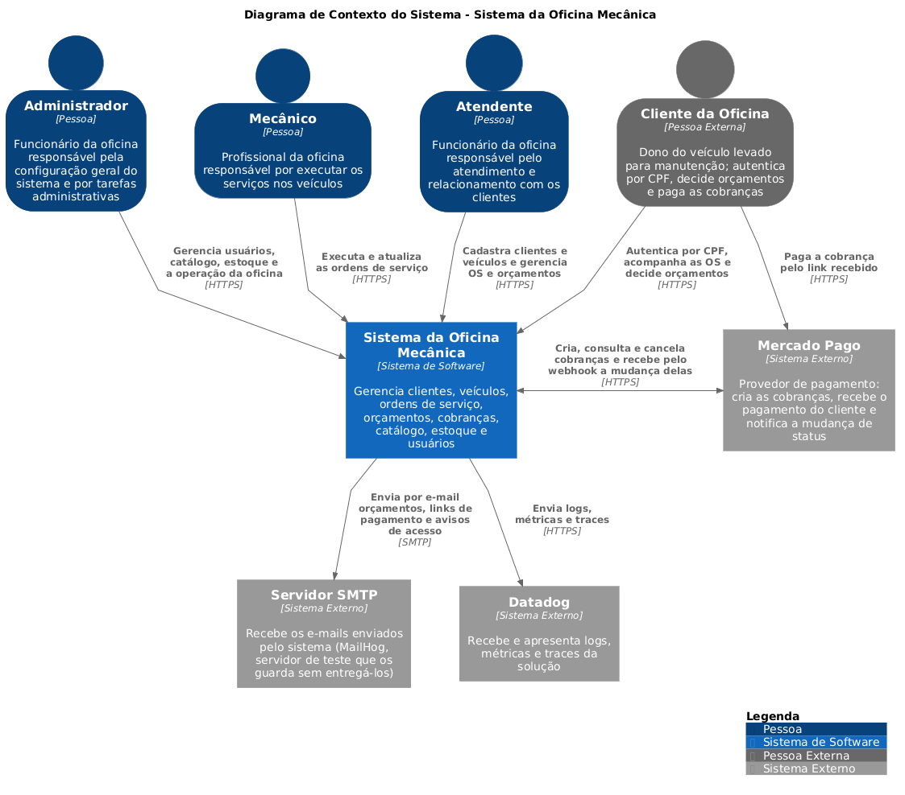

# 🧩 Modelo C4 — Sistema da Oficina Mecânica

Este diretório documenta a arquitetura do **Sistema da Oficina Mecânica** com o [modelo C4](https://c4model.com). O C4 descreve a arquitetura em **níveis de zoom sucessivos** — como aproximar um mapa: o mesmo sistema visto de mais longe (Contexto) ou de mais perto (Container, Componente). O sistema em foco é sempre o mesmo em todos os níveis; só muda o nível de detalhe.

Este projeto documenta os **três primeiros níveis** e, à parte, os diagramas dinâmicos das três Sagas (abertura da OS, aprovação do orçamento e cobrança), que mostram a ordem das interações entre os containers. Cada seção abaixo traz a imagem do diagrama, a descrição dos elementos e as convenções seguidas.

## Índice

- [Como ler os quatro níveis](#como-ler-os-quatro-níveis)
- [Convenções](#convenções)
- [Nível 1 — Contexto do Sistema](#nível-1--contexto-do-sistema)
- [Nível 2 — Container](#nível-2--container)
- [Nível 3 — Componente da API REST](#nível-3--componente-da-api-rest)
- [Diagramas dinâmicos das Sagas](#diagramas-dinâmicos-das-sagas)
- [Documentação relacionada](#documentação-relacionada)

## Como ler os quatro níveis

O C4 define quatro níveis de detalhe. Cada nível é um zoom a mais sobre o **mesmo** sistema:

| Nível | O que mostra | Neste projeto |
|---|---|---|
| **1 · Contexto** | O sistema, seus usuários e os sistemas externos | ✅ [ver](#nível-1--contexto-do-sistema) |
| **2 · Container** | Os blocos executáveis/implantáveis dentro do sistema | ✅ [ver](#nível-2--container) |
| **3 · Componente** | As peças internas de um container | ✅ [ver](#nível-3--componente-da-api-rest) |
| **4 · Código** | Classes/tabelas de um componente | ➖ fora de escopo |

## Convenções

Convenções seguidas em todos os diagramas, para leitura consistente entre os níveis:

- **Nome único do sistema.** O sistema em foco é sempre **"Sistema da Oficina Mecânica"**, idêntico em Contexto, Container e Componente — é o mesmo sistema, só muda o zoom.
- **Tipo explícito em todo elemento.** Cada elemento declara o tipo entre colchetes (`[Pessoa]`, `[Sistema de Software]`, `[Container: tecnologia]`, `[Componente: tecnologia]`).
- **Pessoas com silhueta.** Os atores usam a silhueta oficial de pessoa (círculo + corpo), como nos exemplos de [c4model.com/diagrams/system-context](https://c4model.com/diagrams/system-context) e [.../container](https://c4model.com/diagrams/container).
- **Ícone de componente.** No diagrama de Componente, cada componente leva o ícone UML clássico (dois retângulos), igual à legenda de [c4model.com/diagrams/component](https://c4model.com/diagrams/component), na mesma paleta azul dos demais elementos.
- **Protocolo nas setas.** No Contexto e no Container, cada seta traz a ação e, entre colchetes, o protocolo (HTTPS, HTTP, SQL, SMTP…). No Componente, as setas entre componentes do mesmo container trazem só a ação, e a tecnologia surge quando a relação cruza a fronteira da API, como no acesso do cliente, no Banco de Dados e na Mensageria AWS.
- **Imagem com o fonte.** As imagens são geradas pelo PlantUML com a biblioteca [C4-PlantUML](https://github.com/plantuml-stdlib/C4-PlantUML) v2.14.0, e o fonte de cada diagrama fica embutido no próprio PNG.

## Nível 1 — Contexto do Sistema

O nível mais macro, pensado para stakeholders **não técnicos**: mostra quem usa o sistema e com quais sistemas externos ele conversa, sem nenhum detalhe interno.

As caixas de pessoa descrevem **quem** cada ator é; a ação fica no rótulo da seta, com o protocolo entre colchetes. O sistema aparece como uma caixa só: o API Gateway, os quatro serviços, as duas funções Lambda, os bancos, os caches e a mensageria só aparecem no nível 2. A AWS não aparece como sistema externo porque é a plataforma onde o próprio sistema roda: os recursos gerenciados dela que o sistema usa (API Gateway, Lambda, RDS, ElastiCache, SNS e SQS) são containers do nível 2.

| Elemento | Tipo | Papel |
|---|---|---|
| **Administrador** | Pessoa | Responsável pela configuração geral e por tarefas administrativas; gerencia usuários, serviços, peças, clientes, veículos, ordens de serviço, orçamentos e estoque |
| **Mecânico** | Pessoa | Executa e atualiza as ordens de serviço sob sua responsabilidade |
| **Atendente** | Pessoa | Cadastra clientes e veículos; cria e gerencia ordens de serviço e orçamentos |
| **Cliente da Oficina** | Pessoa externa | Dono do veículo levado para manutenção; autentica por CPF e senha, acompanha as ordens de serviço, aprova ou rejeita orçamentos e paga as cobranças no Mercado Pago, pelo link que recebe por e-mail |
| **Mercado Pago** | Sistema externo | Provedor de pagamento: o sistema cria, consulta e cancela nele as cobranças, o cliente paga nele, e ele avisa o sistema da mudança de cada cobrança por webhook (uma chamada HTTPS que o Mercado Pago faz ao sistema) |
| **Servidor SMTP** | Sistema externo | Recebe os e-mails enviados pelo sistema: orçamento enviado, link de pagamento, falta de estoque e os de acesso (senha inicial e código de redefinição de senha). É o MailHog, um servidor SMTP de teste que guarda os e-mails para consulta, sem entregá-los aos destinatários |
| **Datadog** | Sistema externo | Recebe e apresenta logs, métricas e traces da solução |

## Nível 2 — Container

Um zoom para dentro da fronteira do sistema: os blocos executáveis/implantáveis e como se comunicam.

Dentro do **Sistema da Oficina Mecânica** estão 16 containers:

- o **API Gateway**, a entrada pública;
- as duas funções AWS Lambda: a **Customer Auth**, que faz o login do cliente, e a **Notificação**, que envia os e-mails;
- os quatro serviços NestJS no EKS (o Kubernetes gerenciado da AWS): **Work Order**, **Identity**, **Billing** e **Inventory**. O Work Order é a API REST detalhada no nível 3;
- um banco PostgreSQL no Amazon RDS para cada serviço: **Banco do Work Order**, **Banco do Identity**, **Banco do Billing** e **Banco do Inventory**;
- um cache Valkey no Amazon ElastiCache para cada serviço: **Cache do Work Order**, **Cache do Identity**, **Cache do Billing** e **Cache do Inventory**;
- a **Mensageria**: o tópico SNS FIFO `oficina-events.fifo` e uma fila SQS FIFO para cada consumidor (`work-order.fifo`, `billing.fifo`, `inventory.fifo` e `notification.fifo`), cada uma com a sua DLQ (fila que recebe as mensagens que falharam cinco vezes).

O **Funcionário** reúne o Administrador, o Mecânico e o Atendente do nível 1, que entram pelo mesmo caminho, com o token de funcionário emitido pelo Identity. O **Mercado Pago**, o **Servidor SMTP** e o **Datadog** são os sistemas externos.

Cada serviço é o único que lê e grava o próprio banco e o próprio cache. Quando precisa de um dado de outro serviço, chama as rotas `/internal` do dono, que ficam fora do API Gateway; quando muda o estado de outro serviço, publica uma mensagem pelo outbox (a tabela de mensagens gravada na mesma transação do dado, que um processo do próprio serviço publica depois no tópico). O Work Order conduz as Sagas de abertura, aprovação e cobrança (ver [Arquitetura](../architecture.md)) e é o único consumidor dos eventos de orçamento e de cobrança do Billing e das respostas da reserva de estoque do Inventory. O Identity só publica: grava no outbox os e-mails de acesso. As chamadas `/internal` levadas ao diagrama, conferidas nos clientes HTTP de cada serviço:

| Quem chama | Dono | Rotas |
|---|---|---|
| Customer Auth | Identity | `POST /internal/customer-authentications` |
| Customer Auth | Work Order | `GET /internal/users/:userId/customers` |
| Work Order | Identity | `GET /internal/users/:id` e `POST /internal/customer-users` |
| Identity | Work Order | `GET /internal/users/:userId/customers` |
| Work Order | Billing | `POST /internal/quotes`, `GET` e `DELETE /internal/quotes/:quoteId`, `GET /internal/work-orders/:id/quotes`, `POST /internal/quotes/:quoteId/decisions`, `GET /internal/work-orders/:id/balance` e `GET /internal/work-orders/:id/payments` |
| Billing | Work Order | `GET /internal/work-orders/:id` |
| Work Order | Inventory | `GET /internal/services/:id` e `GET /internal/parts-supplies/:id` |
| Billing | Inventory | `GET /internal/services/:id` e `GET /internal/parts-supplies/:id` |
| Inventory | Billing | `GET /internal/services/:id/quote-usage` e `GET /internal/parts-supplies/:id/quote-usage` |

| Container | Tecnologia | Responsabilidade |
|---|---|---|
| **API Gateway** | Amazon API Gateway HTTP API | Entrada pública. Encaminha `POST /customer-auth/login` à Customer Auth pela integração AWS_PROXY (invoca a função com a requisição inteira e devolve a resposta dela) e cada grupo de rotas ao serviço dono pelo VPC Link (a ligação privada do API Gateway com a rede da solução) e pelo NLB interno (o Network Load Balancer, com uma porta por serviço): `/api/auth`, `/api/users` (exceto `/api/users/{userId}/customers`), `/api/me` e `/api/me/password` ao Identity; `/api/customers`, `/api/vehicles`, `/api/work-orders` (exceto `/api/work-orders/{id}/quotes`), `/api/me/work-orders`, `/api/me/quotes`, `/api/users/{userId}/customers` e as métricas de serviço ao Work Order; `/api/quotes`, `/api/work-orders/{id}/quotes`, `/api/payments` e `POST /webhooks/mercadopago` ao Billing; `/api/services`, `/api/parts-supplies`, `/api/stock-movements` e `/api/stock-reservations` ao Inventory. `/api/health/live`, `/api/health/ready`, `/api/docs` e `/api/docs-json` vão ao Work Order; `/health/{serviço}` e `/docs/{serviço}` levam à prontidão e ao documento OpenAPI de cada um dos quatro serviços. Não há rota genérica nem rota `/internal` |
| **Customer Auth** | AWS Lambda · Node.js 24 | Login do cliente: confere as credenciais no Identity, lê no Work Order os clientes vinculados e emite o `customer-jwt` RS256; repositório [`oficina-mecanica-lambda-customer-auth`](https://github.com/FIAP-15SOAT/oficina-mecanica-lambda-customer-auth) |
| **Notificação** | AWS Lambda · Node.js 24 | Recebe os e-mails da fila `notification.fifo` e os envia por SMTP; repositório [`oficina-mecanica-lambda-notification`](https://github.com/FIAP-15SOAT/oficina-mecanica-lambda-notification) |
| **Work Order** | NestJS 12 · Node.js 24 no EKS | Clientes, veículos, ordens de serviço e os vínculos de acesso do cliente; conduz as Sagas e grava no outbox os comandos ao Billing e ao Inventory e os e-mails ao cliente |
| **Identity** | NestJS 12 · Node.js 24 no EKS | Usuários, credenciais e login dos funcionários; emite o token de funcionário e grava no outbox os e-mails de acesso; repositório [`oficina-mecanica-identity-service`](https://github.com/FIAP-15SOAT/oficina-mecanica-identity-service) |
| **Billing** | NestJS 12 · Node.js 24 no EKS | Orçamentos e cobranças; cria as cobranças no Mercado Pago, recebe o webhook dele e publica os eventos de orçamento e de cobrança; repositório [`oficina-mecanica-billing-service`](https://github.com/FIAP-15SOAT/oficina-mecanica-billing-service) |
| **Inventory** | NestJS 12 · Node.js 24 no EKS | Catálogo de serviços e peças, estoque e reservas por OS; consome os comandos de reserva e de baixa e publica as respostas da reserva; repositório [`oficina-mecanica-inventory-service`](https://github.com/FIAP-15SOAT/oficina-mecanica-inventory-service) |
| **Banco do Work Order** | PostgreSQL 18 (Amazon RDS) | Clientes, endereços, veículos, ordens de serviço com itens e histórico, vínculos com usuários do Identity, estado das Sagas e outbox; repositório [`oficina-mecanica-infra-database-work-order`](https://github.com/FIAP-15SOAT/oficina-mecanica-infra-database-work-order) |
| **Banco do Identity** | PostgreSQL 18 (Amazon RDS) | Usuários e outbox; repositório [`oficina-mecanica-infra-database-identity`](https://github.com/FIAP-15SOAT/oficina-mecanica-infra-database-identity) |
| **Banco do Billing** | PostgreSQL 18 (Amazon RDS) | Orçamentos com os itens, cobranças e outbox; repositório [`oficina-mecanica-infra-database-billing`](https://github.com/FIAP-15SOAT/oficina-mecanica-infra-database-billing) |
| **Banco do Inventory** | PostgreSQL 18 (Amazon RDS) | Serviços, peças, movimentações e reservas de estoque e outbox; repositório [`oficina-mecanica-infra-database-inventory`](https://github.com/FIAP-15SOAT/oficina-mecanica-infra-database-inventory) |
| **Cache do Work Order** | Valkey 9.1 (Amazon ElastiCache) | Detalhe das ordens de serviço (cache-aside, TTL de 12 h) |
| **Cache do Identity** | Valkey 9.1 (Amazon ElastiCache) | Usuário por id (TTL de 12 h) e códigos de redefinição de senha (10 min) |
| **Cache do Billing** | Valkey 9.1 (Amazon ElastiCache) | Detalhe e lista de orçamentos da OS (TTL de 12 h) |
| **Cache do Inventory** | Valkey 9.1 (Amazon ElastiCache) | Serviço e peça por id (TTL de 12 h) |
| **Mensageria** | Amazon SNS FIFO + SQS FIFO | Tópico `oficina-events.fifo` e as filas `work-order.fifo`, `billing.fifo`, `inventory.fifo` e `notification.fifo`, cada uma assinando só os tipos de mensagem do seu consumidor e com a sua DLQ; repositório [`oficina-mecanica-infra-messaging`](https://github.com/FIAP-15SOAT/oficina-mecanica-infra-messaging) |
| **Mercado Pago** | Sistema externo | Checkout Pro (a página de pagamento hospedada pelo Mercado Pago, aberta pelo link enviado ao cliente) pela Orders API (a API do Mercado Pago que cria, consulta e cancela orders, os pedidos de pagamento): as orders das cobranças e as notificações do webhook. A seta Billing ↔ Mercado Pago cobre as duas direções: as chamadas do Billing à Orders API e o webhook, que chega ao Billing pelo API Gateway |
| **Servidor SMTP** | MailHog (externo) | Recebe da Notificação os e-mails ao cliente (servidor SMTP de teste, que guarda os e-mails sem entregá-los); roda no cluster, atrás do NLB |
| **Datadog** | Sistema externo | Recebe e apresenta logs, métricas e traces da solução: os serviços enviam a telemetria ao Datadog Agent do cluster, que a repassa, e as funções Lambda, pela extensão do Datadog que roda junto de cada função |

Os protocolos nas setas:

- os atores entram por **HTTPS** no API Gateway;
- o API Gateway invoca a Customer Auth por integração **AWS_PROXY** (repassa a requisição inteira à função e devolve a resposta dela) e chega aos serviços por **HTTP**, pelo **VPC Link** (a ligação privada do API Gateway com a rede da solução) e pelo **NLB** interno (o Network Load Balancer, que tem uma porta por serviço e encaminha ao cluster);
- a Customer Auth roda fora do cluster e chama as rotas `/internal` do Identity e do Work Order por **HTTP**, pelo NLB;
- os serviços chamam as rotas `/internal` uns dos outros por **HTTP**, pelo endereço interno do Kubernetes (o DNS do Service de cada serviço), sem passar pelo NLB;
- cada serviço acessa o próprio banco por **SQL** (Prisma) e o próprio cache por **RESP sobre TLS** (o protocolo do Valkey, com criptografia obrigatória);
- os serviços publicam no tópico e leem a própria fila por **HTTPS** (AWS SDK);
- a Notificação recebe as mensagens da fila `notification.fifo` por **event source mapping** (a própria AWS lê a fila e invoca a função com as mensagens) e envia os e-mails por **SMTP**, pelo NLB, que encaminha ao MailHog no cluster;
- o Billing chama a Orders API do Mercado Pago por **HTTPS**, com token Bearer, e o Mercado Pago chama o webhook `POST /webhooks/mercadopago` por **HTTPS**, pelo API Gateway, que o encaminha ao Billing; o Billing confere a assinatura `x-signature` de cada chamada;
- a telemetria dos seis containers que executam código (os quatro serviços e as duas funções Lambda) chega ao Datadog por **HTTPS** (a dos serviços pelo Datadog Agent do cluster, a das Lambdas pela extensão do Datadog); o diagrama mostra uma seta só, que sai da fronteira do sistema, e a coleta está descrita em [Observabilidade](../observability.md).

A estratégia Passport externa (`customer-jwt`, RS256) permanece separada da usada pelos funcionários (`jwt`, RS256 com outra chave, emissor e audiência, emitido pelo Identity). O relay do outbox e o consumidor da fila rodam dentro do processo de cada serviço, sem worker separado, e o Job de migração do Kubernetes reutiliza a imagem do serviço; por isso nenhum dos dois é modelado como container à parte.

## Nível 3 — Componente da API REST

O zoom mais interno: as peças que compõem o container **API REST**.

São **oito módulos de negócio** (Minha Conta, Clientes, Veículos, Serviços, Ordens de Serviço, Orçamentos, Cobranças e Rotas Internas) e **cinco componentes transversais** (Guards / Segurança, Repositories, Cache, Mensageria e Gateways), com as dependências reais entre módulos levantadas no código. Destaques do fluxo: **Ordens de Serviço** abre a OS com o orçamento inicial criado no **Billing**, o serviço dono dos orçamentos, pelos **Gateways**, e o apaga se a gravação da OS falha (a Saga de abertura, ver [Arquitetura](../architecture.md#saga-de-abertura)); pelos mesmos **Gateways**, confere no **Identity**, o serviço dono dos usuários, o mecânico atribuído antes de gravar e lê nele o mecânico e os autores do histórico para as respostas; **Clientes** pede ao Identity o usuário de acesso de um cliente e lê os usuários vinculados; **Orçamentos** não tem rota HTTP: a **Mensageria** entrega a ele as mensagens do Billing (orçamento enviado, rejeitado, aprovado e aprovação desfeita) e as respostas da reserva de estoque do **Inventory**, e ele move a OS, conduz a Saga de aprovação (ver [Arquitetura](../architecture.md#aprovação-de-orçamento-com-reserva-de-estoque)), lê o orçamento aprovado pelos **Gateways** e grava no outbox, pelos **Repositories**, o e-mail aos usuários vinculados, lidos no Identity pelos **Gateways** (a **Mensageria** o publica, e a Notificação, a função Lambda de e-mail da solução, o envia); **Cobranças** também não tem rota HTTP: recebe da **Mensageria** as mensagens de cobrança do Billing (cobrança criada, paga ou não paga), conduz a Saga de cobrança (ver [Arquitetura](../architecture.md#saga-de-cobrança)), bloqueia a OS enquanto o cliente paga e a devolve ao status de antes, e grava no outbox o e-mail com o link de pagamento; o **Cliente da Oficina** apresenta o `customer-jwt` ao componente **Guards / Segurança**, que o vincula ao módulo **Minha Conta**, que lê e decide os orçamentos e lê as cobranças no Billing pelos **Gateways**; o **Billing** lê a OS e o **Identity** lê os clientes vinculados a um usuário pelas **Rotas Internas**; e **Ordens de Serviço**, **Orçamentos** e **Cobranças** leem ou invalidam o detalhe da OS no **Cache**.

As dependências de quase todos os módulos em relação a **Guards / Segurança** e **Repositories**, e as de **Clientes** e **Veículos** em relação ao **Cache**, estão descritas no texto desses componentes, e **não desenhadas como setas** — isso evita cerca de 18 setas repetidas que poluiriam o diagrama sem agregar informação. A gravação dos e-mails ao cliente no outbox por **Orçamentos** e **Cobranças** também passa por **Repositories** e está no texto desses dois componentes. Como no exemplo oficial (Figura 3 do material da aula), as setas entre componentes do mesmo container não levam rótulo de tecnologia; a tecnologia aparece somente nas relações que cruzam a fronteira da API, como cliente, Banco de Dados, Cache Distribuído, Mensageria AWS, Billing, Inventory e Identity.

**Módulos de negócio**

| Componente | Tecnologia | Responsabilidade |
|---|---|---|
| **Clientes** | NestJS Module | CRUD de clientes (pessoa física/jurídica) e acesso externo: concessão e revogação de vínculos com usuários do Identity, listagens de vínculos e ativação do cliente |
| **Veículos** | NestJS Module | CRUD de veículos e listagem de veículos por cliente |
| **Serviços** | NestJS Module | Métricas por serviço sobre os itens executados (`GET /services/:id/metrics`); o catálogo de serviços é do Inventory |
| **Ordens de Serviço** | NestJS Module | Abertura com o orçamento inicial no Billing (Saga de abertura), gestão de ordens de serviço, status, histórico e execução dos itens; ao iniciar a execução de uma OS com peças, pede ao Inventory a baixa da reserva; antes da entrega, confere no Billing que o saldo é zero; confere no Identity o mecânico atribuído |
| **Orçamentos** | NestJS Module | Handlers das mensagens de orçamento, sem rota HTTP: o envio leva a OS a aguardar aprovação e grava no outbox o e-mail ao cliente, a rejeição devolve a OS, e a aprovação roda a Saga de aprovação com reserva de estoque no Inventory, desfeita no Billing quando falta estoque, com o e-mail ao cliente gravado no outbox |
| **Cobranças** | NestJS Module | Handlers das mensagens de cobrança, sem rota HTTP: a Saga de cobrança leva a OS a `AWAITING_PAYMENT` e grava no outbox o e-mail com o link quando o Billing cria uma cobrança, devolve a OS ao status de antes quando a cobrança é paga, expira, é recusada ou cancelada, e pede ao Billing o cancelamento quando a OS já não podia ser cobrada |
| **Minha Conta** | NestJS Module | Rotas autenticadas do usuário externo: ordens vinculadas e os orçamentos e as cobranças delas, lidos no Billing (os orçamentos também decididos lá); o perfil e a troca de senha ficam no Identity |
| **Rotas Internas** | NestJS Module | Rotas `/internal` para os outros serviços, sem token e fora do prefixo `/api`; delegam ao Clean Controller existente (`GET /internal/work-orders/:id`, lido pelo Billing, e `GET /internal/users/:userId/customers`, lido pelo Identity) |

**Componentes transversais**

| Componente | Tecnologia | Responsabilidade |
|---|---|---|
| **Guards / Segurança** | NestJS Guards | `AuthenticationGuard` global que nega por padrão (token de funcionário, salvo `@Public()` ou `@CustomerArea()`), `RolesGuard` (RBAC interno) e as estratégias separadas `jwt` (RS256, funcionário, validado só pela assinatura e pelas claims, sem ler o usuário) e `customer-jwt` (RS256, com a conferência do vínculo com cliente ativo) |
| **Repositories** | Prisma | Acesso a dados centralizado e global; todos os módulos de negócio persistem através dele, com o outbox gravado no mesmo Unit of Work |
| **Cache** | NestJS Module · ioredis | Cache-aside do detalhe da OS no Valkey; invalidado depois do commit pelas escritas em OS, orçamentos, cobranças, clientes e veículos |
| **Mensageria** | NestJS Module · AWS SDK | Relay do outbox para o SNS FIFO, inclusive os e-mails ao cliente (`notification.email.send`), e consumidor da fila SQS `work-order.fifo`, com o span `CONSUMER` e os handlers das mensagens do Billing (`billing.quote.sent`, `billing.quote.rejected`, `billing.quote.approved` e `billing.quote.approval_reverted`), das cobranças (`billing.payment.requested`, `billing.payment.approved` e `billing.payment.failed`) e das respostas da reserva de estoque (`inventory.stock.reserved` e `inventory.stock.reservation_failed`) |
| **Gateways** | @nestjs/axios | `HttpBillingQuotesGateway`, `HttpBillingPaymentsGateway`, `HttpInventoryCatalogGateway` e `HttpIdentityUsersGateway` sobre o `InternalHttpClient`: criam, leem, apagam e decidem orçamentos e leem o saldo e as cobranças da OS nas rotas `/internal` do Billing, leem serviços e peças nas do Inventory e leem usuários (`GET /internal/users/:id`) e criam o usuário de acesso de um cliente (`POST /internal/customer-users`) nas do Identity, com prazo de 2 s (5 s nas chamadas que o Billing só responde depois de ler o Inventory), `x-request-id` e `traceparent` |

## Diagramas dinâmicos das Sagas

O diagrama dinâmico do C4 mostra, para um cenário, as interações entre os containers do nível 2 numeradas na ordem em que acontecem. Uma Saga é uma operação que grava em mais de um serviço, cada um no próprio banco, e que desfaz com passos de **compensação** o que já foi gravado quando um passo seguinte falha. O Work Order conduz as três Sagas da solução (abertura da OS, aprovação do orçamento e cobrança) e guarda o estado das duas últimas na tabela `saga_instances` do seu banco (ver [Arquitetura](../architecture.md)).

Como ler os diagramas:

- os números sem letra são o caminho em que tudo dá certo;
- um número com letra é o desvio de uma falha e ocorre no lugar do passo de mesmo número (o `5a` no lugar do `5`), exceto o `6a` da abertura, que ocorre depois do passo 6, quando a gravação da OS falha; os passos com a mesma letra formam um desvio (`5a`, `6a`, `7a`...), e cada compensação traz o motivo no rótulo;
- uma seta com dois números, como `4b / 6a`, é a mesma mensagem enviada por dois desvios;
- nas setas de mensagem, os colchetes trazem a fila SQS FIFO do destinatário: o serviço grava a mensagem no outbox na mesma transação do dado, o relay a publica no tópico SNS FIFO `oficina-events.fifo`, e o tópico a entrega à fila do consumidor;
- as setas com `GET`, `POST` ou `DELETE` em `/internal` são chamadas HTTP diretas entre os serviços, e as que vêm de fora da fronteira passam pelo API Gateway.

### Saga de abertura

A abertura é síncrona, dentro da requisição do funcionário: o Work Order confere no Identity o mecânico atribuído e cria no Billing o orçamento inicial, que o Billing confere e precifica no catálogo do Inventory, antes de gravar a OS, e apaga esse orçamento se a gravação da OS falha (`6a`).

### Saga de aprovação

A aprovação começa com a decisão do Cliente da Oficina repassada ao Billing (a aprovação pelo funcionário, `PATCH /api/quotes/:id` no Billing, segue igual a partir do passo 3) e reserva as peças no Inventory: um orçamento sem peças leva a OS a `APPROVED` já no passo 3, a falta de estoque desfaz a aprovação no Billing e avisa o cliente por e-mail (`5a` a `9a`), e uma OS que saiu de `AWAITING_APPROVAL` antes do passo 3, cancelada por exemplo, leva o orçamento a `REJECTED` (`4b` e `5b`).

### Saga de cobrança

A cobrança bloqueia a OS em `AWAITING_PAYMENT` enquanto o cliente paga no Mercado Pago e a devolve ao status de origem (`APPROVED` ou `COMPLETED`) quando a cobrança é paga (passo 9) ou quando expira, é recusada ou é cancelada pelo funcionário (`9a`, a compensação), e o Work Order pede ao Billing o cancelamento da cobrança quando a OS já não podia ser cobrada ao chegar o passo 4 (`5b` a `7b`). Se o cliente já tinha pago quando o cancelamento chega ao Mercado Pago, o Mercado Pago recusa o cancelamento, e o Billing publica `billing.payment.approved` no lugar do `7b`: a Saga termina `COMPLETED`, a OS não muda e o valor entra no saldo.

## Documentação relacionada

- 🏛️ [Arquitetura](../architecture.md) — Clean Architecture, DDD, ciclos de vida, Unit of Work, exceções.
- 🏗️ [Infra · Visão Geral](../infra/overview.md) — a infraestrutura como sistema (inclui as vistas de deployment).
- 📈 [Observabilidade](../observability.md) — logs, métricas, traces, dashboards e alertas.
- 📐 [ADRs](../adr) — decisões arquiteturais.
- 🌐 [c4model.com](https://c4model.com) — referência oficial do modelo C4.
