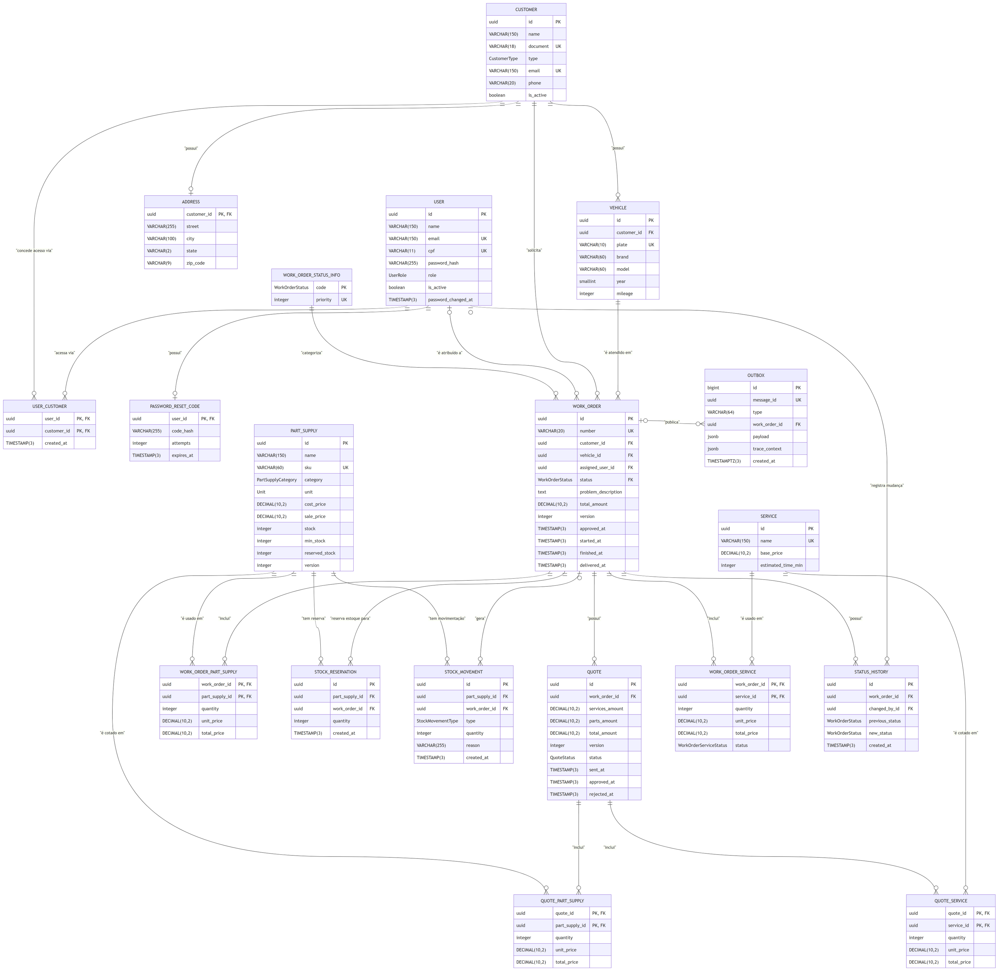

# Banco de Dados

Modelo relacional (PostgreSQL) da API, definido em [`prisma/schema.prisma`](../app/prisma/schema.prisma) e versionado via migrations em [`prisma/migrations/`](../app/prisma/migrations/).

## Diagrama entidade-relacionamento

Os tipos de coluna mostrados no diagrama são os tipos **reais gerados no Postgres** (`VARCHAR(n)`, `TIMESTAMP(3)`, `DECIMAL(10,2)`, os enums nomeados, etc.), conferidos a partir das migrations — não os tipos abstratos do schema Prisma (`String`, `Int`, `DateTime`).

## Tabelas e relacionamentos

### Identidade e acesso

- **`users`** (`User`) — funcionários internos (`ADMIN`, `MECHANIC`, `ATTENDANT`) e também a conta-base de todo Cliente da Oficina que acessa via CPF (`role` nulo nesse caso — ver [ADR 0004](adr/0004-autenticacao-de-clientes.md)). `email` e `cpf` são únicos; `cpf` é opcional (só funcionários com acesso externo o possuem).
- **`customers`** (`Customer`) — clientes da oficina (pessoa física ou jurídica, `type`). `document` (CPF/CNPJ) e `email` são únicos.
- **`user_customers`** (`UserCustomer`) — vínculo N:N entre `users` e `customers` que autoriza o acesso externo por CPF: um `User` pode acessar os dados de um ou mais `Customer` (ex.: um contador que acessa vários clientes PJ). Chave primária composta `(user_id, customer_id)`.
- **`customer_addresses`** (`Address`) — endereço 1:1 de um `Customer`. Chave primária é o próprio `customer_id` (sem id/timestamps próprios); apagado em cascata com o cliente.
- **`password_reset_codes`** (`PasswordResetCode`) — código de redefinição de senha em vigor por usuário (`user_id` como chave primária — no máximo um código ativo por vez), emitido por um Admin.

### Veículos e catálogo

- **`vehicles`** (`Vehicle`) — veículos de um `Customer` (`plate` única). Um cliente pode ter vários veículos; cada veículo pertence a exatamente um cliente.
- **`services`** (`Service`) — catálogo de serviços oferecidos (nome único, preço base).
- **`parts_supplies`** (`PartSupply`) — catálogo de peças e insumos (`category` distingue os dois), com controle de estoque (`stock`, `min_stock`, `reserved_stock`) e concorrência otimista (`version`).

### Ordem de Serviço (OS)

- **`work_order_statuses`** (`WorkOrderStatusInfo`) — tabela de referência (lookup, populada pelo seed): associa cada `WorkOrderStatus` a uma `priority` numérica (1–9), usada para ordenar a listagem de OS por status em ordem de negócio, não alfabética (ver [Ciclo de vida da Ordem de Serviço](architecture.md#ciclo-de-vida-da-ordem-de-serviço)).
- **`work_orders`** (`WorkOrder`) — a Ordem de Serviço, aggregate root do domínio. Referencia um `Customer`, um `Vehicle`, opcionalmente um `User` atribuído (mecânico), e seu `status` é FK para `work_order_statuses`. Concorrência otimista via `version`.
- **`work_order_services`** / **`work_order_part_supplies`** (`WorkOrderService` / `WorkOrderPartSupply`) — itens de linha da OS (serviços e peças/insumos aplicados), com chave primária composta `(work_order_id, service_id | part_supply_id)` em vez de surrogate key. Apagados em cascata com a OS.
- **`status_history`** (`StatusHistory`) — histórico de transições de status de uma OS, com o usuário que efetuou a mudança (`changed_by_id`, opcional).

### Orçamento

- **`quotes`** (`Quote`) — orçamento vinculado a uma OS, também um aggregate root próprio (concorrência otimista via `version`).
- **`quote_services`** / **`quote_part_supplies`** (`QuoteService` / `QuotePartSupply`) — itens de linha do orçamento, mesmo padrão de chave composta dos itens de OS.

### Estoque

- **`stock_movements`** (`StockMovement`) — histórico de entradas/saídas/ajustes de estoque de uma peça/insumo, opcionalmente vinculado à OS que o originou (`work_order_id` nulo em ajustes manuais; `onDelete: SetNull` preserva o histórico mesmo se a OS for excluída).
- **`stock_reservations`** (`StockReservation`) — reserva de estoque de uma peça/insumo para uma OS específica, liberada ou efetivada conforme o ciclo de vida da OS.

### Mensageria

- **`outbox`** (`OutboxMessage`) — mensagens a publicar, gravadas na mesma transação da mudança de estado que as origina e apagadas pelo relay depois de publicadas no tópico SNS; por isso a tabela fica quase sempre vazia.
  - **Duas identidades.** `id` (`BIGSERIAL`) dá ao relay a ordem de criação, que a fila FIFO preserva por OS: o UUID v4 não tem ordem, e `created_at` empata no mesmo milissegundo. `message_id` (UUID v4, único) é a identidade da mensagem entre serviços, usada como `MessageDeduplicationId` e como chave de idempotência de quem consome; um número sequencial colidiria entre serviços.
  - **Conteúdo.** `type` é um tipo do catálogo de mensagens (`app/src/domain/messaging/`), `payload` é o corpo (`JSONB`) e `work_order_id` é a OS da mensagem, nula nas mensagens sem OS.
  - **`trace_context`** guarda o contexto de trace W3C da requisição que gravou a linha (`traceparent` e, quando houver, `tracestate`). O relay publica dentro desse contexto, e o processamento no serviço que consome aparece no mesmo trace da requisição.
  - **`created_at`** é `TIMESTAMPTZ(3)`: o `occurredAt` da mensagem sai dele em UTC, qualquer que seja o fuso da sessão do PostgreSQL.
  - **Um relay por vez.** Toda réplica do serviço roda um relay, que a cada 500 ms abre uma transação, lê até 10 linhas por `id`, publica uma a uma e apaga as publicadas. A transação começa com `pg_try_advisory_xact_lock(7310001)`, uma trava consultiva do PostgreSQL: só uma transação a obtém, as outras recebem `false` na hora e pulam aquele ciclo, sem esperar nem ocupar conexão, e a trava se solta sozinha no `COMMIT` ou no `ROLLBACK`. Sem ela, duas réplicas publicariam linhas do mesmo lote ao mesmo tempo e a ordem da OS na fila FIFO se perderia. O número não tem significado: é a chave que identifica essa trava no banco (`OUTBOX_RELAY_LOCK_KEY`), igual em todas as réplicas e sem outro uso no mesmo banco.
  - **`work_order_id`** é FK `Restrict` para `work_orders`. Os outros serviços usam a mesma tabela sem a FK, porque lá o id é de uma OS que não pertence a eles.

## Enums

`UserRole`, `CustomerType`, `WorkOrderStatus`, `WorkOrderServiceStatus`, `QuoteStatus`, `StockMovementType`, `Unit`, `PartSupplyCategory`. `UserRole` **não** ganhou um valor `CUSTOMER` — o acesso externo não é modelado como papel interno (ver [ADR 0004](adr/0004-autenticacao-de-clientes.md)).

## Convenções de modelagem

- **IDs**: `uuid` v4 (`@db.Uuid`) gerados pelo Prisma — exceto o número da OS, gerado por uma **sequence PostgreSQL** (`work_order_number_seq`, formatada com 6 dígitos zero-padded — `000001`, `000002`, …), e o `id` sequencial do `outbox` (ver [Mensageria](#mensageria)).
- **Timestamps**: `created_at` / `updated_at` em todas as entidades não-imutáveis (`Address`, `StatusHistory`, `StockMovement` e `StockReservation` guardam apenas `created_at`).
- **Concorrência otimista**: coluna `version Int @default(1)` em `WorkOrder`, `Quote` e `PartSupply`.
- **Cascade deletes** para itens dependentes (`WorkOrderService`, `WorkOrderPartSupply`, `QuoteService`, `QuotePartSupply`, `StatusHistory`, `StockReservation`, `Address`).
- **`StockMovement.work_order_id`** usa `onDelete: SetNull` para preservar histórico de movimentação após exclusão da OS.
- **Unicidade**: `User.email`, `User.cpf`, `Customer.email`, `Customer.document`, `Vehicle.plate`, `PartSupply.sku`, `Service.name`, `WorkOrder.number`.
- **Identidades compostas**: `WorkOrderService`, `WorkOrderPartSupply`, `QuoteService` e `QuotePartSupply` usam chave primária composta `(parentId, itemId)` em vez de surrogate key.
- **Índices secundários** por colunas usadas em filtros (`status`, `customer_id`, `vehicle_id`, `assigned_user_id`, `part_supply_id`, `work_order_id`, etc.) e índice composto `(status, created_at)` em `work_orders` para listagens ordenadas.

## Conexão em produção

O Amazon RDS gera e mantém a master password em um Secret do AWS Secrets
Manager, com rotação automática desabilitada. No CD da API, o job `prepare-deploy` descobre os metadados da instância por
`vars.RDS_INSTANCE_IDENTIFIER`, lê o estágio `AWSCURRENT`, aplica percent-encoding
ao usuário e à senha e materializa a URL com TLS no Secret Kubernetes
`database-credentials`. O Job de migration/seed e o Deployment consomem a mesma
chave `DATABASE_URL`; não existe senha do banco nos settings do GitHub.

A preparação usa Node.js inline e aplica o manifesto por stdin. `db-migrate`
executa somente migration/seed; `app-deploy` aplica a imagem e aguarda o rollout.
O deploy é greenfield, sem annotation/output de versão da credencial; uma
mudança isolada do Secret não renova o environment de Pods existentes.

Esse fluxo não altera o contrato do Prisma nem o runtime. CI/E2E usam bancos
descartáveis e uma URL própria. Detalhes e alternativas estão no
[ADR 0017](adr/0017-materializacao-da-credencial-do-banco-no-cd.md).

## Referências

- [ADR 0001 — Uso do PostgreSQL como banco de dados relacional](adr/0001-uso-do-postgresql-como-banco-de-dados.md)
- [ADR 0004 — Autenticação externa de clientes por CPF](adr/0004-autenticacao-de-clientes.md)
- [ADR 0010 — Concorrência otimista via coluna `version`](adr/0010-concorrencia-otimista-via-version.md)
- [`oficina-mecanica-infra-database-work-order` — ADRs de dados gerenciados (RDS e ElastiCache)](https://github.com/FIAP-15SOAT/oficina-mecanica-infra-database-work-order/tree/main/docs/adr)
