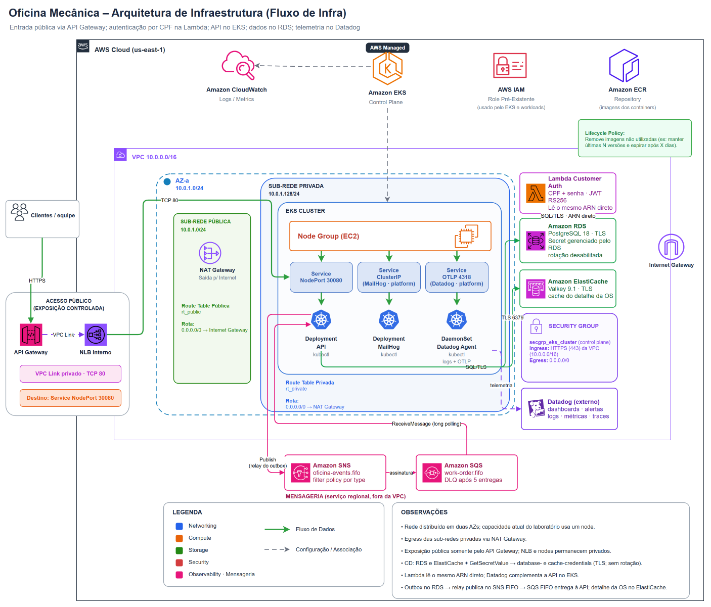
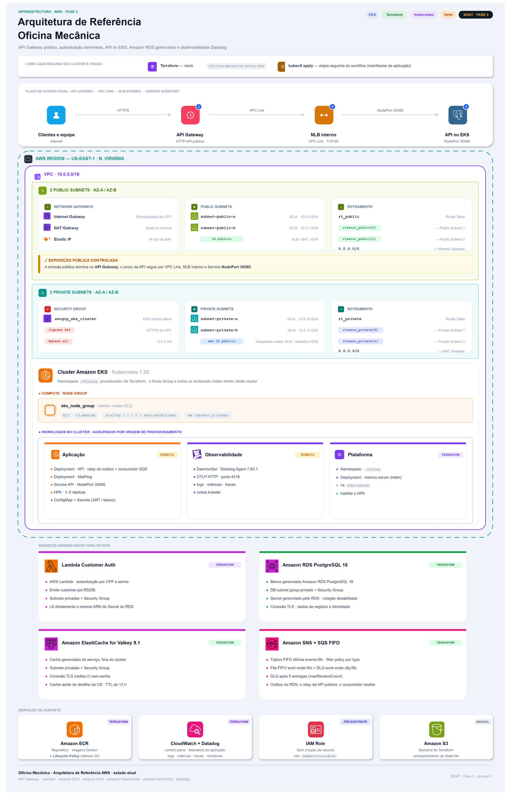

# 🏗️ Infraestrutura · Visão Geral

Este documento detalha a infraestrutura aplicada no projeto: descreve o deploy em **AWS + Amazon EKS** como um **sistema único** — quais são os componentes, quem provisiona cada um, quem chama quem em tempo de execução e para que serve cada recurso. Os detalhes por ferramenta ficam nos aprofundamentos de [Terraform](terraform.md), [Kubernetes](kubernetes.md) e [CI/CD](ci-cd.md), referenciados ao longo da documentação.

A solução roda inteiramente na região **`us-east-1`**, dentro de uma única VPC, num cluster EKS — com a persistência relacional em **Amazon RDS, fora do cluster** —, autoscaling de pods via `metrics-server`/HPA e **entrada pública por um AWS API Gateway**, que alcança a aplicação por um caminho **inteiramente privado** (VPC Link → NLB interno → NodePort dos nós). Os worker nodes e o NLB não têm exposição pública; o endpoint do control plane do EKS aceita acesso público e privado, protegido por IAM/RBAC. O `kubectl port-forward` permanece disponível como acesso de diagnóstico. O ambiente é um **`prod-simulated`** de laboratório (AWS Academy), o que motiva várias das escolhas minimalistas discutidas em [Limitações](#limitações-e-o-que-produção-exigiria).

## Índice

- [Diagramas de infraestrutura](#diagramas-de-infraestrutura)
- [As sete camadas de provisionamento](#as-sete-camadas-de-provisionamento)
- [Inventário de componentes e ownership](#inventário-de-componentes-e-ownership)
- [Topologia de rede](#topologia-de-rede)
- [Fluxo em tempo de execução (quem chama quem)](#fluxo-em-tempo-de-execução-quem-chama-quem)
- [Fluxo de provisionamento e deploy](#fluxo-de-provisionamento-e-deploy)
- [Postura de segurança](#postura-de-segurança)
- [Limitações e o que produção exigiria](#limitações-e-o-que-produção-exigiria)
- [Documentação relacionada](#documentação-relacionada)

## Diagramas de infraestrutura

A primeira vista preserva o fluxo arquitetural resumido; a segunda detalha rede, ownership e workloads sem alterar a separação entre os recursos gerenciados e o cluster.





## As sete camadas de provisionamento

A solução é criada em **sete camadas** com ciclos de vida distintos — seis stacks Terraform e os manifests da aplicação aplicados pelo pipeline:

| # | Camada / Repositório | Ferramenta | O que provisiona | Estado |
|---|---|---|---|---|
| 1 | **`oficina-mecanica-infra-base`** | Terraform | Rede AWS (VPC, subnets públicas/privadas, IGW, NAT Gateway, Route Tables) e Security Group de identidade dos nós do EKS (`secgrp-eks-nodes-oficina-mecanica`) | S3 `infra/prod-simulated/infra-base/terraform.tfstate` |
| 2 | **`oficina-mecanica-infra-k8s`** | Terraform + Helm + CD (`kubectl`) | EKS (cluster + Launch Template IMDSv2 + node group com 2 nós `t3.medium` e `LabRole`), ECRs por serviço (`force_delete`), NLB interno multi-listener + SMTP, CloudWatch, Security Group, Namespaces por serviço + `platform` + `metrics-server` e manifests do `platform` (Datadog Agent e MailHog) | S3 `infra/prod-simulated/infra-k8s/terraform.tfstate` (e `k8s/platform/` via `platform-apply`) |
| 3 | **`oficina-mecanica-infra-database-work-order`** | Terraform | **Amazon RDS (PostgreSQL 18)** e **Amazon ElastiCache (Valkey 9.1)** dedicados ao `work-order`, fora do cluster, nas subnets privadas da VPC | S3 `infra/prod-simulated/infra-database-work-order/terraform.tfstate` |
| 4 | **`oficina-mecanica-work-order-service` (`k8s/*.yaml`)** | **CD (`kubectl`)** | API (Deployment/Service/HPA), ConfigMap, Secrets e Job de migração, no namespace `work-order`; MailHog e Agent são do `infra-k8s`, no namespace `platform` | Sem state — reaplicado a cada deploy |
| 5 | **`oficina-mecanica-api-gateway`** | Terraform | **AWS API Gateway (HTTP API)**, stage, VPC Link, security group e log de acesso — a **API Gateway** da solução | S3 `infra/prod-simulated/api-gateway/terraform.tfstate` |
| 6 | **`oficina-mecanica-lambda-customer-auth`** | Terraform | **AWS Lambda** de autenticação externa de clientes, nas subnets privadas: função, security group próprio, log group, segredo da chave de assinatura, concorrência reservada e a `aws_lambda_permission` que autoriza o API Gateway a invocá-la | S3 `infra/prod-simulated/lambda-customer-auth/terraform.tfstate` |
| 7 | **`oficina-mecanica-custom-monitoring`** | Terraform | Quatro dashboards, oito monitores de query, um teste sintético com monitor associado e a configuração de tags da métrica de latência no Datadog | S3 `infra/prod-simulated/custom-monitoring/terraform.tfstate` |

Os **seis** stacks Terraform têm states separados. Kubernetes e database consomem a rede da Camada 1; o API Gateway consome a rede da Camada 1 e os listeners privados da Camada 2 (`service_listener_arns`, `service_listener_ports` e o alias de transição `api_nlb_listener_arn`); a Lambda consome rede, database e `api_execution_arn`; o monitoramento consome o endpoint público exportado pelo Gateway. A Camada 4 não usa Terraform: seus manifests são aplicados pelo pipeline de CD, porque imagem, configuração e escala mudam com mais frequência que a plataforma. Detalhes da divisão em [kubernetes.md › Motivo da divisão](kubernetes.md#motivo-da-divisão) e [terraform.md](terraform.md).

## Inventário de componentes e ownership

O mapa **"quem provisiona o quê / para que serve"**, agrupado pelas sete camadas:

### Camada 1 — `oficina-mecanica-infra-base` (Terraform)

| Recurso | Definido em | Finalidade |
|---|---|---|
| **VPC** `10.0.0.0/16` | `networking.tf` | Rede isolada que hospeda todo o cluster; DNS support/hostnames habilitados |
| **2 subnets públicas** (`10.0.0.0/24`, `10.0.1.0/24`) | `networking.tf` | Hospedam o NAT Gateway; `map_public_ip_on_launch`; tag `kubernetes.io/role/elb` |
| **2 subnets privadas** (`10.0.10.0/24`, `10.0.11.0/24`) | `networking.tf` | Hospedam os nodes do EKS; sem IP público; tag `kubernetes.io/role/internal-elb` |
| **Internet Gateway** | `networking.tf` | Entrada/saída pública da VPC (rota das subnets públicas) |
| **NAT Gateway + Elastic IP** | `networking.tf` | Egresso das subnets privadas para a internet, com IP fixo; **único**, na `public[0]` |
| **Route tables** (`rt_public`, `rt_private`) | `networking.tf` | `rt_public` → IGW; `rt_private` → NAT Gateway |
| **Security Group** `secgrp-eks-nodes-oficina-mecanica` | `security_group.tf` | Identidade lógica dos worker nodes do EKS (`eks_nodes_security_group_id`), sem regras locais; anexado via Launch Template no `infra-k8s` |

### Camada 2 — `oficina-mecanica-infra-k8s` (Terraform + `k8s/platform/`)

| Recurso | Definido em | Finalidade |
|---|---|---|
| **EKS cluster** (`1.35`) | `eks.tf` | Control plane Kubernetes gerenciado; endpoint **público e privado**; usa a role IAM pré-existente `LabEksClusterRole` (lida via `data`, injetada por `EKS_CLUSTER_ROLE_NAME`) |
| **Launch Template + EKS node group** (`t3.medium`, `2/2/2`) | `eks.tf` | Worker nodes EC2 nas **subnets privadas** (`desired = min = max = 2`, até 34 pods) usando a role fixa `LabRole` (`data.aws_iam_role.lab_role`), IMDSv2 obrigatório (`http_tokens = "required"`, `http_put_response_hop_limit = 2`) e anexando o SG do cluster + `secgrp-eks-nodes-oficina-mecanica` |
| **Security Group** `secgrp-eks-cluster-*` | `eks.tf` | Control plane do EKS: ingress `443` **da CIDR da VPC**, egress `0.0.0.0/0` |
| **CloudWatch Log Group** | `eks.tf` | Logs do control plane (`api`, `audit`, `authenticator`, `controllerManager`, `scheduler`); retenção **14 dias** |
| **ECRs por serviço** (`ecr-oficina-mecanica-<contexto>`) | `ecr.tf` | Quatro repositórios (`work-order`, `identity`, `billing`, `inventory`) gerados via `for_each`; `scan_on_push`; criptografia `AES256`; `force_delete = true`; **mantém as últimas 20 imagens** por serviço |
| **Namespaces** (`work-order`, `identity`, `billing`, `inventory` e `platform`) | `k8s_namespace.tf` | Isolamento por bounded context e namespace compartilhado `platform` |
| **metrics-server** (Helm `3.13.0`) | `k8s_metrics_server.tf` | Métricas de CPU/memória em `kube-system`; **habilita o HPA** |
| **NLB interno** `nlb-oficina-mecanica` | `nlb.tf` | Fronteia os microsserviços para o API Gateway e o SMTP do MailHog para a VPC; nas **subnets privadas**, sem IP público, com **cross-zone habilitado** |
| **Target Groups e Listeners por serviço** (`tg-oficina-mecanica-<contexto>`) | `nlb.tf` | Alvos `instance` nos **NodePorts `30080` (`work-order`, listener `80`), `30081` (`identity`, listener `8081`), `30082` (`billing`, listener `8082`) e `30083` (`inventory`, listener `8083`)**; health check **HTTP em `/api/health/ready`** e attachment ao ASG do node group |
| **Target Group e Listener SMTP** (`tg-oficina-mecanica-smtp`) | `nlb.tf` | Listener `1025/TCP` → NodePort `31025` (`instance` mode, health check TCP) expondo o MailHog do namespace `platform` na VPC |
| **Regras de ingress** dos NodePorts | `nlb.tf` | Liberam `30080`–`30083` e `31025` no SG gerenciado do cluster **apenas para a CIDR da VPC** |
| **Datadog Agent e MailHog** (`k8s/platform/`) | `.github/workflows/cd.yml` (`platform-apply`) | `datadog-secret` criado via stdin a partir de `DD_API_KEY`, DaemonSet `datadog-agent` (`gcr.io/datadoghq/agent:7.83.1`, OTLP HTTP `:4318`) e `mailhog` (`mailhog/mailhog:v1.0.1`, ClusterIP `1025`/`8025` + NodePort `31025`) no namespace `platform` |

### Camada 3 — `oficina-mecanica-infra-database-work-order` (Terraform)

| Recurso | Definido em | Finalidade |
|---|---|---|
| **Instância RDS** PostgreSQL 18 (`rds-oficina-mecanica-work-order`, `db.t4g.micro`, Single-AZ, 20 GiB GP3) | [`oficina-mecanica-infra-database-work-order`](https://github.com/FIAP-15SOAT/oficina-mecanica-infra-database-work-order) (`rds.tf`) | Persistência relacional do `work-order`, **fora do cluster**; credencial gerenciada pelo RDS no Secrets Manager |
| **ElastiCache Valkey 9.1** (`cache-oficina-mecanica-work-order`, `cache.t4g.micro`, single-node) | `elasticache.tf` | Cache distribuído do `work-order` com TLS obrigatório, repouso criptografado e AUTH token gerado via `ephemeral` + `secret_string_wo` no Secrets Manager (`cache-oficina-mecanica-work-order-auth-token`) |
| **Subnet groups + Security Groups** (`secgrp-rds-…` e `secgrp-cache-…`) | `rds.tf`, `elasticache.tf`, `security_group.tf` | Alocam RDS e Valkey nas subnets privadas da VPC, com ingress restrito a `secgrp-eks-nodes-oficina-mecanica` (e CIDRs privadas da VPC no RDS de forma transitória até a C-20) e sem regras de egress |

### Camada 6 — `oficina-mecanica-lambda-customer-auth` (Terraform)

| Recurso | Arquivo | Papel |
|---|---|---|
| **Função Lambda** `lbd-oficina-mecanica-customer-auth` (`nodejs24.x`, 1024 MB, 15 s) | [`oficina-mecanica-lambda-customer-auth`](https://github.com/FIAP-15SOAT/oficina-mecanica-lambda-customer-auth) | Autenticação externa de clientes por CPF; emite o token `RS256` que esta API verifica pela estratégia `customer-jwt`. Anexada às **subnets privadas**, alcança o RDS da Camada 3 |
| **Security Group** próprio | mesma stack | Sem regra de ingresso — a função é invocada por chamada de serviço, não por rede; egresso liberado |
| **CloudWatch Log Group** (retenção **14 dias**) | mesma stack | Formato **texto**, para preservar o contrato de log estruturado da função |
| **Secret** da chave privada de assinatura | mesma stack | Contêiner declarado no Terraform; o **valor** é escrito pelo CD daquele repositório, para não transitar pelo state |
| **`aws_lambda_permission`** escopada à rota | mesma stack | Autoriza o API Gateway da Camada 5 a invocar a função. Sem ela, `POST /customer-auth/login` responde `500` com erro de integração |
| **Concorrência reservada** (`10`) | mesma stack | Limita as conexões simultâneas ao RDS compartilhado — protege também esta API |

O par de chaves é o mesmo dos dois lados: a metade **pública** vive no secret `CUSTOMER_JWT_PUBLIC_KEY` deste repositório, e a **privada** no environment de produção daquele.

### Camada 4 — `k8s/*.yaml` (aplicado pelo CD via `kubectl`)

| Recurso | Manifesto | Finalidade |
|---|---|---|
| **Job** `db-migrate` (one-shot) | `00-db-migrate-job.yaml` | `prisma migrate deploy` + `db seed`; renderizado por run; TTL de 14 dias; `backoffLimit: 0` |
| **Secrets** `jwt-private-keys`, `jwt-public-keys`, `database-credentials` e `cache-credentials` | `01-secrets.yaml` (placeholders base64 preenchidos pelo CD e aplicados por stdin) | `STAFF_JWT_PRIVATE_KEY` / `STAFF_JWT_REFRESH_PRIVATE_KEY`, `CUSTOMER_JWT_PUBLIC_KEY` / `STAFF_JWT_PUBLIC_KEY` / `STAFF_JWT_KEY_ID`, `DATABASE_URL` (RDS) e `CACHE_URL` (`rediss://`, ElastiCache) |
| **ConfigMap** `work-order-config` | `02-work-order-configmap.yaml` | Envs não-sensíveis (`NODE_ENV`, `PORT`, expirações JWT, `BCRYPT_SALT_ROUNDS`, `MAIL_HOST/PORT`, `TZ`, `CUSTOMER_JWT_ISSUER`/`CUSTOMER_JWT_AUDIENCE`, `LOG_LEVEL`, `OTEL_SERVICE_*`, `TRUSTED_PROXY_CIDRS`, `AWS_REGION`, `WORK_ORDER_QUEUE_NAME`, `MESSAGING_TOPIC_ARN`, `CACHE_TTL_SECONDS` e as três chaves de telemetria). O CD renderiza `OTEL_EXPORTER_OTLP_ENDPOINT` a partir da variável homônima do GitHub Actions (valor vazio desliga o SDK por completo) e `MESSAGING_TOPIC_ARN` com a conta da sessão AWS |
| **Deployment** `work-order-service` | `03-work-order-deployment.yaml` | A API NestJS; sem `replicas` (o HPA é o dono); `:sha` imutável; labels UST com `version`; três probes HTTP em `/api/health/live` (startup + liveness) e `/api/health/ready` (readiness) |
| **Service** `work-order-service` (**NodePort** `3000` → `30080`) | `04-work-order-service.yaml` | Expõe a API dentro do cluster **e** na porta `30080` dos nós, que é o destino do target group do NLB interno. `NodePort` é um superconjunto de `ClusterIP`: o DNS interno e o `port-forward` seguem iguais |
| **HPA** `work-order-service-hpa` (`1`→`2`) | `05-api-hpa.yaml` | Autoscaling da API por CPU (70%) e memória (80%) |

### Camada 5 — `oficina-mecanica-api-gateway` (Terraform)

| Recurso | Definido em | Finalidade |
|---|---|---|
| **API Gateway HTTP API** + stage `$default` | [`oficina-mecanica-api-gateway`](https://github.com/FIAP-15SOAT/oficina-mecanica-api-gateway) | **Ponto de entrada público** da solução; publica `POST /customer-auth/login`, `POST /api/auth/login` e `ANY /api/{proxy+}` |
| **VPC Link V2** + security group só de egress | idem | ENIs nas subnets privadas; é o que permite a integração privada alcançar o NLB interno sem sair da VPC |
| **CloudWatch Log Group** do log de acesso | idem | Log de acesso JSON do API Gateway, retenção **14 dias** — sem corpo, sem query string e sem cabeçalho de autorização |

> O API Gateway **não autentica e não autoriza**: encaminha o cabeçalho de autorização intacto e a decisão continua sendo da API (ver [ADR 0004](../adr/0004-autenticacao-de-clientes.md)). A única responsabilidade que ela assume no fluxo de autenticação é a limitação de frequência das duas rotas de login.

### Camada 7 — `oficina-mecanica-custom-monitoring` (Terraform)

| Recurso | Definido em | Finalidade |
|---|---|---|
| **4 dashboards** | `dashboard_*.tf` | Visão geral, API, ordens de serviço e Kubernetes |
| **8 monitores de query** | `monitors_*.tf` | Erros e latência da API, falhas de ordens de serviço, memória/reinícios de pods, erros da Lambda, envio de e-mail e dependência degradada |
| **Teste sintético + monitor associado** | `synthetics.tf` | Verifica `GET /api/health/ready` pelo endpoint público; fica `live` ou `paused` conforme `environment_online` |
| **Configuração de tags da métrica** | `metrics.tf` | Mantém `env`, `service`, `http.route` e `http.response.status_code` indexados em `http.server.request.duration` e habilita percentis |

### Camada de coleta de plataforma (`namespace platform`) e configuração do CD

A aplicação declara os três sinais (traces, métricas e logs), e a coleta no cluster é centralizada no namespace `platform` pelo `oficina-mecanica-infra-k8s`:

| Componente | Estado | Finalidade |
|---|---|---|
| Agente com receiver OTLP (DaemonSet no namespace `platform`) | Versionado em `oficina-mecanica-infra-k8s/k8s/platform/`; aplicado pelo job `platform-apply` do CD do `infra-k8s` | Recebe traces e métricas em `http://datadog-agent.platform.svc.cluster.local:4318`, lê o stdout dos contêineres e as métricas de kubelet/cAdvisor. O CD deste repositório não aplica o Agent |
| Correlação nos logs JSON da API | `trace-correlation.ts` + `mixin` de `logging.module.ts`; ingestão pelo Agent | Inclui `trace_id`/`span_id` com span ativo; o pré-processamento JSON do Datadog reconhece esses campos, sem exigir um pipeline customizado declarado neste repositório |
| **Monitor sintético externo** | Declarado em `oficina-mecanica-custom-monitoring/terraform/synthetics.tf` | Mede disponibilidade pelo caminho público completo, incluindo API Gateway, VPC Link, NLB e aplicação |
| Dashboards e monitores | Declarados no repositório `oficina-mecanica-custom-monitoring` | Quatro dashboards e nove monitores no total, contando o monitor associado ao teste sintético |

Os controles são independentes. O `infra-k8s` mantém o Datadog Agent e o MailHog ativos no namespace `platform`, e o CD deste repositório não os aplica; `OTEL_EXPORTER_OTLP_ENDPOINT` (`http://datadog-agent.platform.svc.cluster.local:4318`) é renderizado no ConfigMap e decide se o SDK da aplicação inicia. Valor vazio desliga o SDK, e um endpoint válido ativa a exportação. Como o ConfigMap é consumido por variáveis de ambiente, o valor novo só chega aos Pods criados depois dele (o CD não executa `rollout restart`). Ver [ADR 0005](../adr/0005-opentelemetry.md).

## Topologia de rede

Fiel ao repositório [`oficina-mecanica-infra-base`](https://github.com/FIAP-15SOAT/oficina-mecanica-infra-base) (`networking.tf` e `variables.tf`):

- **VPC** `10.0.0.0/16`, nas **2 primeiras AZs** de `us-east-1` (`slice(azs, 0, 2)` → `us-east-1a`, `us-east-1b`).
- **Subnets públicas**: `10.0.0.0/24` (AZ-a) e `10.0.1.0/24` (AZ-b) — associadas à `rt_public` (rota `0.0.0.0/0` → **Internet Gateway**). Hospedam o NAT Gateway.
- **Subnets privadas**: `10.0.10.0/24` (AZ-a) e `10.0.11.0/24` (AZ-b) — associadas à `rt_private` (rota `0.0.0.0/0` → **NAT Gateway**). Hospedam os nodes do EKS.
- **Um** Internet Gateway e **um** NAT Gateway (+ Elastic IP), este na `public[0]`.
- **Security Group** do control plane: ingress **`443` apenas da CIDR da VPC**; egress liberado.

> Existem **duas** subnets por camada porque o EKS **exige ≥ 2 AZs** — há inclusive um bloco `validation` em `variables.tf` que falha o `plan` com menos de 2 CIDRs. Isso é um requisito do control plane, **não** alta disponibilidade do workload — ver [Limitações](#limitações-e-o-que-produção-exigiria).

## Fluxo em tempo de execução (quem chama quem)

Há **dois** caminhos de entrada: o público, pelo API Gateway, e o de diagnóstico, por túnel. A API alcança o MailHog do namespace `platform` por DNS de Service, o PostgreSQL e o Valkey pelos endpoints privados do RDS e do ElastiCache, fora do cluster, e o SNS/SQS pela API da AWS:

```
Cliente (internet) ──HTTPS──▶ API Gateway (HTTP API)
                                   │  ANY /api/{proxy+} e POST /api/auth/login
                                   ▼
                              VPC Link V2 (ENIs nas subnets privadas)
                                   ▼
                              NLB interno :80 ──▶ Node :30080 (NodePort)
                                                        │
Dev/QA ──┤ kubectl port-forward 3000:3000 ├──▶ Service work-order-service (:3000)
                                                        │
                                                        ▼
                                     Pod work-order-service (:3000), ns work-order
                     DATABASE_URL │   CACHE_URL │   SNS/SQS │   MAIL_HOST │
                                  ▼             ▼           ▼             ▼
                   Amazon RDS (:5432)  ElastiCache   Amazon SNS e   Service mailhog (:1025)
                   fora do cluster     Valkey        SQS FIFO       ns platform
                                       (:6379, TLS)  (via NAT)

Cliente (internet) ──HTTPS POST /customer-auth/login──▶ API Gateway ──▶ Lambda de
                                                       autenticação de clientes
                                                       (repositório próprio)

Pod (subnet privada) ──egresso 0.0.0.0/0──▶ NAT Gateway ──▶ Internet
Node (subnet privada) ──pull da imagem :sha──▶ Amazon ECR (via NAT)
```

- **Entrada pública**: o endereço do API Gateway. `ANY /api/{proxy+}` cobre toda a API e `POST /api/auth/login` existe como rota explícita apenas para receber limitação de frequência mais restritiva. O API Gateway **não valida credenciais**: um `401` numa rota protegida é produzido pela própria API. Um caminho não publicado recebe `404` **do API Gateway**, sem alcançar o cluster.
- **Entrada de diagnóstico**: `kubectl port-forward -n work-order svc/work-order-service 3000:3000` → API em `http://localhost:3000` (Swagger em `/api/docs`). O `NodePort` também possui `ClusterIP`, portanto o acesso por DNS interno e o `port-forward` usam o mesmo Service. Ver [kubernetes.md › Acesso à aplicação](kubernetes.md#acesso-à-aplicação-em-kubernetes).
- **Endereço de origem do cliente**: fica registrado **no log de acesso do API Gateway**, não na aplicação. HTTP APIs convertem a família `X-Forwarded-*` no cabeçalho padrão `Forwarded` (RFC 7239), que o Express não interpreta — por isso `TRUSTED_PROXY_CIDRS` continua vazio, e isso é decisão fechada, não pendência. A ligação entre os dois lados é o `x-request-id`: o API Gateway o sobrescreve com o identificador da requisição dela, e a API já prefere esse cabeçalho de entrada, de modo que a linha do log de acesso e a linha do log estruturado compartilham o mesmo identificador.
- **API → PostgreSQL**: via `DATABASE_URL` (`database-credentials`) apontando para o endpoint do **Amazon RDS**, fora do cluster, alcançado pela rede a partir das subnets privadas. Quem reporta se esse caminho está de pé é a `readinessProbe` da API em `/api/health/ready` — não existe pod de banco para inspecionar.
- **API → Valkey**: via `CACHE_URL` (`cache-credentials`), `rediss://` com o auth token, apontando para o endpoint primário do **ElastiCache**, fora do cluster.
- **API → SNS/SQS**: publica no tópico `oficina-events.fifo` e consome a fila `work-order.fifo` com o papel do nó, sem credencial AWS em Secret.
- **API → MailHog**: SMTP em `mailhog.platform.svc.cluster.local:1025` (do `work-order-config`), para os e-mails de aprovação/rejeição de orçamento.
- **Egresso**: pods e nodes nas subnets privadas saem para a internet **pelo NAT Gateway** (inclusive o `pull` das imagens do ECR — não há VPC endpoints).

## Fluxo de provisionamento e deploy

A entrega segue a separação entre os sete repositórios:

```
[oficina-mecanica-infra-base]
          ├──▶ [oficina-mecanica-infra-k8s] ─────────────────────▶ [oficina-mecanica-work-order-service (CD)]
          ├──▶ [oficina-mecanica-infra-database-work-order] ─────┘
          └──▶ [oficina-mecanica-api-gateway] ◀── listener do NLB
                         ├──▶ [oficina-mecanica-lambda-customer-auth]
                         └──▶ [oficina-mecanica-custom-monitoring]
```

1. **`oficina-mecanica-infra-base`**: Provisiona a VPC, subnets públicas/privadas, IGW, NAT Gateway, tabelas de roteamento e o Security Group de identidade dos nós (`secgrp-eks-nodes-oficina-mecanica`), exportando o estado no S3.
2. **`oficina-mecanica-infra-k8s`**: Consome a VPC, subnets e `eks_nodes_security_group_id` do estado de rede via `data.terraform_remote_state`, provisionando cluster EKS, Launch Template (IMDSv2 hop limit 2) e Node Group (2 nós `t3.medium` com `LabRole`), repositórios ECR por serviço, NLB interno multi-listener + SMTP, namespaces por serviço + `platform` e Metrics Server, além de aplicar o Datadog Agent e o MailHog no namespace `platform` via job `platform-apply`.
3. **`oficina-mecanica-infra-database-work-order`**: Consome a VPC, as subnets privadas e `eks_nodes_security_group_id` e provisiona o RDS PostgreSQL 18 (`rds-oficina-mecanica-work-order`), o ElastiCache Valkey 9.1 (`cache-oficina-mecanica-work-order`), subnet groups e security groups dedicados ao contexto `work-order`. O RDS mantém seu Secret no Secrets Manager e o token do Valkey é gravado via atributos write-only (`secret_string_wo`).
4. **`oficina-mecanica-work-order-service` (CD)**:
   - **`build-push-image`**: Constrói a imagem Docker multi-stage da aplicação NestJS e publica no Amazon ECR a tag por commit (`:sha`) e a tag móvel `:latest`; com o input `image_tag` do `workflow_dispatch`, pula o build e a migração e reusa a imagem publicada (rollback manual).
   - **`prepare-deploy`**: Descobre metadados/ARN pelo RDS, espera `available`/`active`, lê `AWSCURRENT` e materializa `DATABASE_URL` com percent-encoding e TLS em `database-credentials` usando Node.js inline e stdin. Também espera o ElastiCache, lê o endpoint e o secret do auth token e materializa `CACHE_URL` em `cache-credentials` por stdin. Em outro step, aplica as chaves privadas do token de funcionário em `jwt-private-keys`, as chaves públicas e o `kid` em `jwt-public-keys` e o ConfigMap, sem publicar outputs.
   - **`db-migrate`**: Após build e preparação, executa somente o Job descartável de `prisma migrate deploy` + `prisma db seed` e aguarda sucesso, bloqueando o deploy em falha/timeout. Não roda no rollback manual por `image_tag`.
   - **`app-deploy`**: Após sucesso da preparação e da migration, recebe a imagem do build, renderiza o pod template, aplica os manifests Kubernetes (Deployment, Service, HPA), valida o rollout e faz o smoke `GET /health/work-order` pelo API Gateway; falha do rollout ou do smoke executa `kubectl rollout undo`. O deploy greenfield não usa annotation/output de versão da credencial nem renova Pods automaticamente por mudança isolada do Secret.

5. **`oficina-mecanica-api-gateway`**: Consome a VPC, as subnets privadas e o `api_nlb_listener_arn`, provisionando HTTP API, VPC Link, integrações, rotas e log de acesso.
6. **`oficina-mecanica-lambda-customer-auth`**: Consome rede, endpoint/credencial do RDS e execution ARN do Gateway, provisionando a função e a permissão da rota `POST /customer-auth/login`.
7. **`oficina-mecanica-custom-monitoring`**: Consome o endpoint público do Gateway e provisiona dashboards, monitores, teste sintético e configuração de tags no Datadog.

O detalhamento job a job (gates, `environment: production`, `ENABLE_DEPLOY`, secrets) está em [ci-cd.md › Workflow de CD](ci-cd.md#2-workflow-de-cd-cdyml).

Ao desfazer o caminho público, respeite a ordem inversa das dependências: reverter o Service de NodePort antes de retirar o encaminhamento do Gateway deixa o target group do NLB sem destino na porta `30080`.

## Postura de segurança

- **A aplicação é pública apenas através do API Gateway.** O Service da API é `NodePort`, alcançável a partir dos nós; **não há ALB nem Ingress públicos**. O único caminho externo é o **API Gateway** → VPC Link → **NLB interno** (sem IP público, nas subnets privadas) → NodePort. A regra de security group que libera a `30080` aceita apenas a **CIDR da VPC**, então a porta não é alcançável da internet nem que alguém descubra o IP de um nó. O `kubectl port-forward` (autenticado pelo RBAC) segue como acesso de diagnóstico.
- **O API Gateway não é um controle de autenticação.** Ela encaminha o cabeçalho de autorização intacto e não o inspeciona, valida ou registra em log; `401`/`403` continuam sendo produzidos pela API. O que o API Gateway acrescenta é **limitação de frequência** nas duas rotas de login — um alvo **agregado por rota** e de melhor esforço, não uma cota por cliente.
- **Consequência aceita: `/api/docs`, `/api/docs-json` e os endpoints de health passam a ser publicamente alcançáveis** pela rota de proxy. É decisão consciente, pelo caráter acadêmico e demonstrativo, e não por falta de alternativa — as opções (não montar o Swagger em produção, ou exigir `AWS_IAM` na rota exata) existem e não foram escolhidas. Registrada em `docs/security.md` do repositório do Gateway.
- **Consequência aceita: a autorização é aplicada por controller, não por guard global.** Hoje todos os controllers de negócio declaram `@UseGuards` e `auth`/`health` são exceções deliberadas — não há buraco atual. O que muda com `ANY /api/{proxy+}` é o **custo de um esquecimento futuro**: um controller novo sem `@UseGuards` fica público na internet sem passar por nenhum outro repositório.
- **Endpoint do EKS é público (mas autenticado).** O control plane tem `endpoint_public_access = true` **e** `endpoint_private_access = true`: o servidor de API do Kubernetes é alcançável pela internet, porém protegido por autenticação/autorização IAM+RBAC. O Security Group do control plane só aceita `443` **da CIDR da VPC**.
- **Nodes em subnets privadas.** Sem IP público; todo egresso passa pelo NAT Gateway.
- **Fluxo de segredos.** O CD usa apenas `RDS_INSTANCE_IDENTIFIER`, `CACHE_REPLICATION_GROUP_ID` e `K8S_NAMESPACE` como Variables, descobre o restante na AWS e materializa `DATABASE_URL` em `database-credentials` e `CACHE_URL` em `cache-credentials`. `jwt-private-keys` fica restrito às chaves privadas `STAFF_JWT_PRIVATE_KEY`/`STAFF_JWT_REFRESH_PRIVATE_KEY`, vindas dos secrets do repositório, e `jwt-public-keys` a material público: `CUSTOMER_JWT_PUBLIC_KEY` (secret do repositório) e `STAFF_JWT_PUBLIC_KEY`/`STAFF_JWT_KEY_ID` (secrets da organização, lidas também pelos outros serviços). Pods e Jobs não leem segredos da AWS, e nenhum ESO/CSI/ASCP foi introduzido. Detalhes em [ci-cd.md › Injeção de secrets](ci-cd.md#injeção-de-secrets-da-aplicação).
- **ECR com `scan_on_push`** e imagens criptografadas (`AES256`); análise SAST/DAST cobre o código e a API em execução — ver [Segurança](../security.md).

## Limitações e o que produção exigiria

Este é um ambiente **acadêmico** com orçamento de laboratório; as decisões abaixo são conscientes. Documentá-las é parte do rigor do projeto.

- **Autoscaling é de pods (API), não de cluster.** O HPA do `work-order-service` escala **1→2 réplicas** por CPU (70%) e memória (80%). O node group é mantido **fixo em 2 nós** (`desired = min = max = 2`, dois `t3.medium`): não há Cluster Autoscaler nem Karpenter. *Produção*: escala dinâmica do node group e autoscaling de nodes caso a demanda de pods exceda a capacidade disponível.
- **Um único NAT Gateway entre duas AZs.** As 2 subnets por camada atendem à exigência de ≥ 2 AZs do EKS e distribuem os **2 worker nodes** do Node Group, mas todo o egresso das subnets privadas continua passando por **1 NAT Gateway** (na `public[0]`) — ponto único de falha para saída à internet. *Produção*: um NAT Gateway por AZ.
- **Sem VPC endpoints.** O `pull` de imagens do ECR e o acesso ao state no S3 saem pela internet (NAT/IGW). *Produção*: VPC endpoints (gateway para S3, interface para ECR/CloudWatch) reduzem custo de NAT e mantêm o tráfego privado.
- **ECR `MUTABLE`, mas o pipeline fixa `:sha`.** O repositório permite sobrescrever tags, porém o CD publica com tag imutável por commit (`:sha`) e move `latest` em paralelo — imutabilidade por **convenção**, não imposta pelo registry. *Produção*: `IMMUTABLE` no ECR para garantir por política.
- **State com lock nativo do S3.** O backend usa `use_lockfile = true` (Terraform ≥ 1.11) em vez de uma tabela DynamoDB de lock — mais simples, sem recurso extra.
- **A coleta depende de configuração operacional.** O Datadog Agent e o MailHog rodam no namespace `platform`, aplicados pelo job `platform-apply` do CD do `oficina-mecanica-infra-k8s` (que exige `DD_API_KEY`). Neste repositório, só `vars.OTEL_EXPORTER_OTLP_ENDPOINT` (`http://datadog-agent.platform.svc.cluster.local:4318`) liga ou desliga o SDK da aplicação. Dashboards, oito monitores de query e o teste sintético com monitor associado são declarados no repositório de monitoramento.
- **A capacidade de pods é limitada a dois nodes.** Cada `t3.medium` suporta até 17 pods com a configuração atual do VPC CNI (34 pods no total nos 2 nós); os microsserviços, os HPAs, os workloads de sistema, o MailHog e o DaemonSet do Agent compartilham esse teto. Ver [kubernetes.md › Autoscaling](kubernetes.md#autoscaling-da-api-hpa).
- **O balanceador falha aberto, e com um nó só isso é o caso comum.** Se **nenhum** alvo estiver saudável — ou o target group estiver vazio —, o NLB volta a encaminhar para todos, independentemente da saúde deles. Com `desired = min = max = 1`, qualquer reinício do nó ou queda do banco cai nesse caso. Consequência prática: sem banco, `/api/health/ready` responde `503` **vindo da aplicação** (não um `5xx` do API Gateway) e `/api/health/live` responde `200` — é a prontidão, e não a vivacidade, que distingue "a solução responde" de "a solução está utilizável". O API Gateway só devolve `5xx` própria quando o caminho de rede em si falha (VPC Link inativo, listener ausente, conexão recusada). *Produção*: mais de um nó, fora do orçamento deste laboratório.
- **Sem TLS entre o API Gateway e o cluster.** O listener do NLB é TCP:80; a criptografia termina no API Gateway. Coerente com a postura atual do cluster, que também não tem TLS interno. *Produção*: listener HTTPS com certificado no balanceador.
- **Custo é o driver das escolhas.** O control plane do EKS, o NAT Gateway, o RDS `db.t4g.micro` Single-AZ e o NLB interno existem enquanto as respectivas stacks estão aplicadas. O NLB é um recurso incondicional da stack Terraform do Kubernetes.

## Documentação relacionada

- 🌍 [Infra · Terraform](terraform.md) — stacks, estados remotos, entradas/saídas, como aplicar.
- ☸️ [Infra · Kubernetes](kubernetes.md) — manifests, Amazon RDS, health probes e deploy manual.
- 🔄 [Infra · CI/CD](ci-cd.md) — workflows de CI, CD, SAST e DAST; ordem de deploy; secrets/variables.
- 🌐 [`oficina-mecanica-api-gateway`](https://github.com/FIAP-15SOAT/oficina-mecanica-api-gateway) — o API Gateway: rotas, contrato OpenAPI, integração privada, observabilidade e ADRs do API Gateway.
- 🔒 [Segurança](../security.md) — mitigações no código e relatórios (ZAP, SonarQube).
- 🧩 [Modelo C4](../c4/README.md) — Contexto, Containers e Componentes (visão C4 Model).
