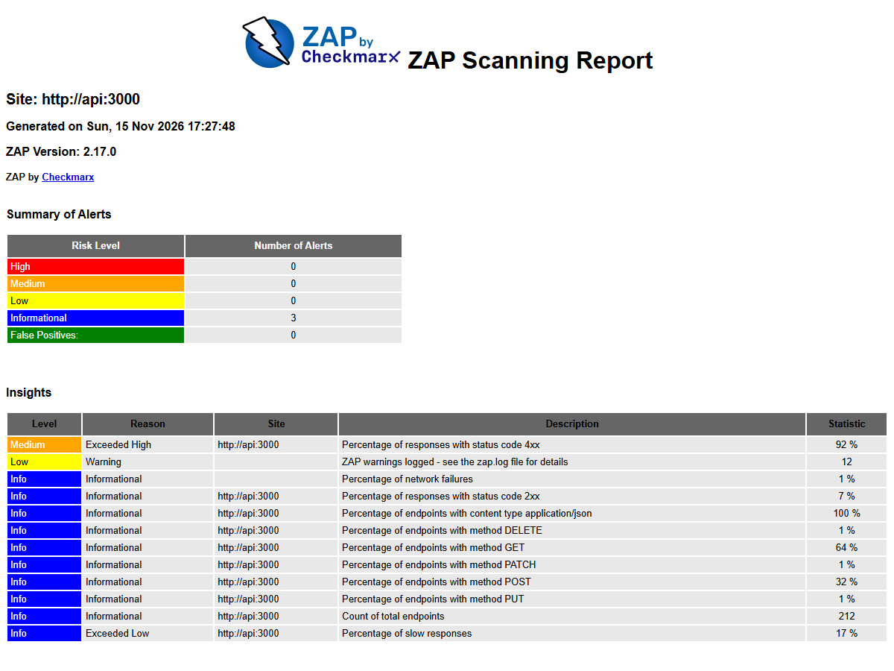
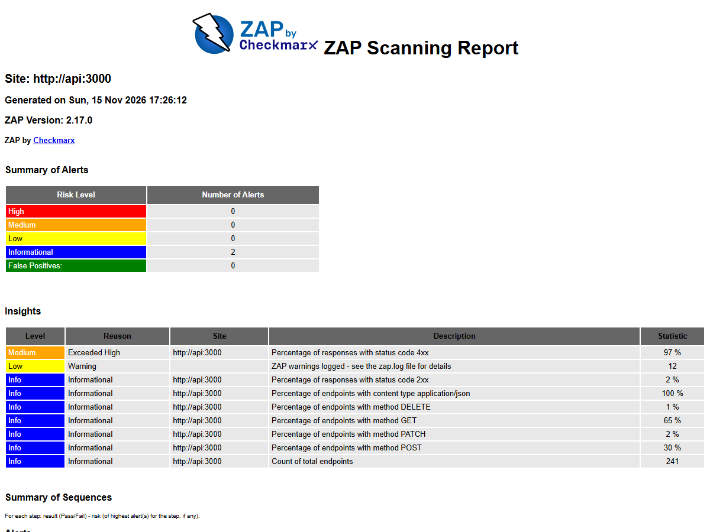
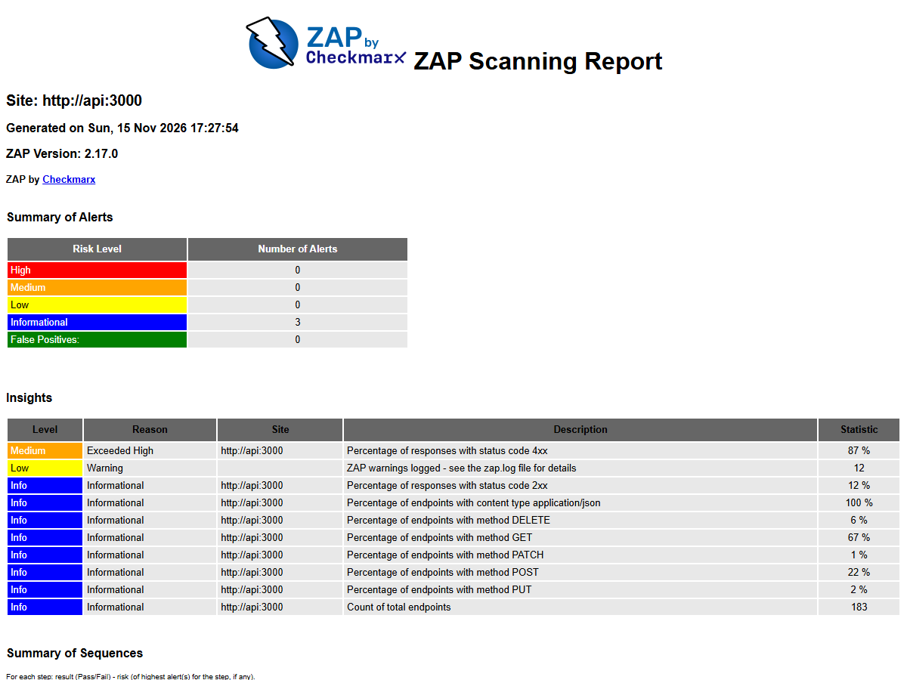

# 📊 Evidências de qualidade

Esta página reúne, para os quatro serviços e as duas funções Lambda da solução, as evidências de cobertura de testes, de análise estática (SAST, a análise do código sem executá-lo) e de análise dinâmica (DAST, o ataque automatizado à API em execução). Os valores foram lidos em 15/11/2026, das execuções dos workflows nessa data e da API do SonarQube Cloud, o serviço que analisa a qualidade e a segurança do código; os badges e os links levam ao estado atual.

## Índice

- [Cobertura e SonarQube Cloud](#cobertura-e-sonarqube-cloud)
- [DAST com o OWASP ZAP](#dast-com-o-owasp-zap)
- [Relatórios da Fase 3](#relatórios-da-fase-3)

## Cobertura e SonarQube Cloud

Cada serviço e cada Lambda roda `npm run test:cov` no job **Unit Tests** do workflow **CI**, e o Jest reprova a execução abaixo de 100% em linhas, comandos, funções e ramos. O workflow **SAST** envia esse relatório de cobertura (o `lcov` dos testes unitários) ao SonarQube Cloud, que aplica o quality gate, o conjunto de critérios que o código novo precisa cumprir, e o workflow falha quando o gate reprova.

| Repositório | Cobertura | Quality gate | Bugs, vulnerabilidades e hotspots de segurança | Projeto no SonarQube Cloud |
| --- | --- | --- | --- | --- |
| Work Order | 100% | Aprovado | 0, 0 e 0 | [`oficina-mecanica-work-order-service`](https://sonarcloud.io/summary/overall?id=FIAP-15SOAT_oficina-mecanica-work-order-service) |
| Identity | 100% | Aprovado | 0, 0 e 0 | [`oficina-mecanica-identity-service`](https://sonarcloud.io/summary/overall?id=FIAP-15SOAT_oficina-mecanica-identity-service) |
| Billing | 100% | Aprovado | 0, 0 e 0 | [`oficina-mecanica-billing-service`](https://sonarcloud.io/summary/overall?id=FIAP-15SOAT_oficina-mecanica-billing-service) |
| Inventory | 100% | Aprovado | 0, 0 e 0 | [`oficina-mecanica-inventory-service`](https://sonarcloud.io/summary/overall?id=FIAP-15SOAT_oficina-mecanica-inventory-service) |
| Lambda notification | 100% | Aprovado | 0, 0 e 0 | [`oficina-mecanica-lambda-notification`](https://sonarcloud.io/summary/overall?id=FIAP-15SOAT_oficina-mecanica-lambda-notification) |
| Lambda customer-auth | 100% (541 de 541 comandos, 207 de 207 ramos), no [log do CI](https://github.com/FIAP-15SOAT/oficina-mecanica-lambda-customer-auth/actions/runs/43740330807) | Aprovado no [workflow SAST](https://github.com/FIAP-15SOAT/oficina-mecanica-lambda-customer-auth/actions/runs/43743019232) | Visíveis só para membros da organização | [`oficina-mecanica-lambda-customer-auth`](https://sonarcloud.io/summary/overall?id=FIAP-15SOAT_oficina-mecanica-lambda-customer-auth), projeto privado |

O projeto da customer-auth está privado no SonarQube Cloud, então o badge dela e o link acima só abrem para quem é membro da organização `fiap-15soat`. Para a entrega, um administrador da organização o torna público em **Administration → Project Visibility**, como os outros cinco.

Os badges de cobertura e de quality gate ficam no topo do README de cada repositório e se atualizam a cada análise da `main`:

| Repositório | Cobertura | Quality gate |
| --- | --- | --- |
| Work Order |  |  |
| Identity |  |  |
| Billing |  |  |
| Inventory |  |  |
| Lambda notification |  |  |

## DAST com o OWASP ZAP

O workflow **DAST** de cada serviço sobe a API com o banco, o cache e a mensageria em containers descartáveis, assina um token de funcionário de teste e roda o OWASP ZAP, um scanner de segurança que lê o contrato OpenAPI e ataca cada rota. O scan reprova o Pull Request quando aparece um alerta que as regras de `.zap/rules.tsv` não ignoram. As quatro execuções abaixo são do Pull Request de 15/11/2026 e terminaram sem alerta de risco alto, médio ou baixo; os informativos são respostas 4xx esperadas, conteúdo marcado como não armazenável em cache e, no Identity, o reconhecimento da rota de login.

| Serviço | Execução | Alertas altos, médios e baixos | Informativos |
| --- | --- | --- | --- |
| Work Order | [DAST](https://github.com/FIAP-15SOAT/oficina-mecanica-work-order-service/actions/runs/43740676848) | 0 | 3 |
| Identity | [DAST](https://github.com/FIAP-15SOAT/oficina-mecanica-identity-service/actions/runs/43740693998) | 0 | 3 |
| Billing | [DAST](https://github.com/FIAP-15SOAT/oficina-mecanica-billing-service/actions/runs/43740662705) | 0 | 2 |
| Inventory | [DAST](https://github.com/FIAP-15SOAT/oficina-mecanica-inventory-service/actions/runs/43740766914) | 0 | 3 |

O relatório completo (HTML e JSON) fica no artifact `zap-report` de cada execução. As duas Lambdas não têm DAST: nenhuma tem servidor HTTP próprio para o ZAP varrer, porque a customer-auth é invocada pela integração do API Gateway e a notification pela fila `notification.fifo`. A customer-auth registra a decisão na [ADR 0006](https://github.com/FIAP-15SOAT/oficina-mecanica-lambda-customer-auth/blob/main/docs/adr/0006-sem-analise-dinamica.md).

O resumo de cada relatório:

| Work Order | Identity |
| --- | --- |
|  |  |

| Billing | Inventory |
| --- | --- |
|  |  |

## Relatórios da Fase 3

A pasta [`reports/`](../reports) guarda os relatórios do ZAP e do SonarQube da Fase 3, quando a solução era uma API só. Eles ficam como histórico; as evidências da Fase 4 são as desta página.
