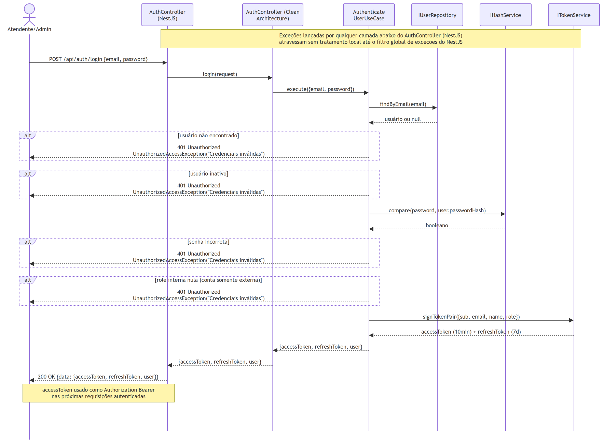
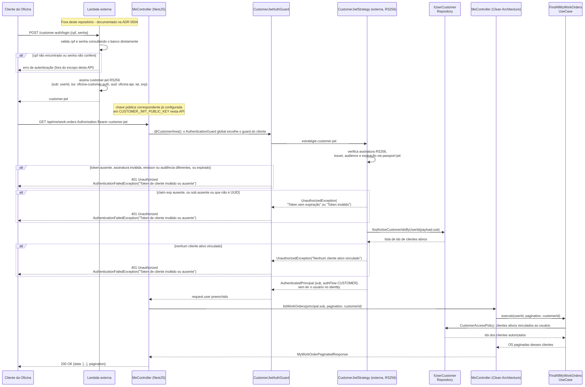

# Diagramas de Sequência

Quatro fluxos centrais da aplicação, em notação UML: login interno, abertura de Ordem de Serviço, autenticação externa do Cliente da Oficina por CPF e aprovação de orçamento com reserva de estoque. Gerados via draw.io a partir de Mermaid, com XML editável embutido nos PNGs.

Nos três primeiros, existe uma camada de **Controller** duas vezes: o `Controller` do NestJS (em `infrastructure/http/controllers/`, borda HTTP — decorators de rota, DTOs, Swagger) delega para o `Controller` da Clean Architecture (em `interface-adapters/`, sem nenhuma dependência de framework), que por sua vez chama o caso de uso. Ver [ADR 0009](adr/0009-clean-architecture-ddd-em-camadas.md). No da aprovação de orçamento, a área do cliente (**Minha Conta**) aparece num participante só, para dar espaço às mensagens trocadas com o Billing e o Inventory.

## Login interno

`POST /api/auth/login {email, password}` — os quatro caminhos de falha (usuário inexistente, inativo, senha incorreta, sem role interna) lançam a mesma exceção genérica (401 "Credenciais inválidas"); só o evento de log distingue a causa, para não virar oráculo de enumeração de contas. O `accessToken` emitido no fim é o mesmo usado como `Authorization: Bearer` no diagrama seguinte.

## Abertura de Ordem de Serviço

`POST /api/work-orders`, a partir do `accessToken` obtido no login — passa pelo `AuthenticationGuard`, o guard global que delega ao `JwtAuthGuard`/`JwtStrategy` (incluindo a checagem de `passwordChangedAt`), e pelo `RolesGuard` e chega ao `CreateWorkOrderUseCase`, que conduz a **Saga de abertura**: valida cliente, veículo e mecânico (404/409/422), cria o orçamento inicial no Billing, o serviço dono dos orçamentos, quando há itens (`POST /internal/quotes`, antes da transação: a recusa do Billing volta como está, Billing ou Inventory fora do ar → 503), e grava a OS e o histórico numa transação. Se a transação falha, o orçamento é apagado no Billing (`DELETE /internal/quotes/:id`) e o erro volta ao chamador. Regras completas em [Saga de abertura](architecture.md#saga-de-abertura).

## Autenticação externa do Cliente da Oficina (CPF)

A função serverless (`POST /customer-auth/login`, documentada na [ADR 0004](adr/0004-autenticacao-de-clientes.md), fora deste repositório) autentica por CPF + senha consultando o banco diretamente — nunca um proxy do login interno — e assina o `customer-jwt` com sua chave privada. A primeira chamada autenticada mostra o `AnyAuthGuard` tentando as duas estratégias Passport em sequência, e todos os ramos de rejeição da `CustomerJwtStrategy` (token sem `exp`, usuário inativo, `iat` anterior à última troca de senha, nenhum vínculo ativo) — todos convergindo para 401.

Ver [Identidade externa, autenticação e autorização por vínculo](architecture.md#identidade-externa-autenticação-e-autorização-por-vínculo) para o raciocínio completo sobre por que a autorização é resolvida a cada requisição, nunca embutida no JWT.

## Aprovação de orçamento com reserva de estoque

O funcionário aprova o orçamento no Billing (`PATCH /api/quotes/:id`) ou o Cliente da Oficina decide em `POST /api/me/quotes/:id/decisions`, que este serviço confere e repassa ao Billing. A aprovação é uma **Saga**: uma sequência de transações locais, cada uma num serviço, ligada por mensagens, em que a falha de um passo dispara uma **compensação** que desfaz o que os passos anteriores gravaram. O work-order conduz a Saga e guarda o estado dela na tabela `saga_instances`.

- **Aprovação no Billing.** O Billing responde `200`, grava o orçamento `APPROVED`, rejeita os outros orçamentos abertos da OS e publica `billing.quote.approved`, com os itens e o total, que chega pela fila SQS FIFO `work-order.fifo` ao `SqsConsumerService`.
- **Início.** O `StartQuoteApprovalUseCase` grava numa transação a OS (com a versão), a Saga e, com peças, o comando `inventory.stock.reserve` no **outbox** (a tabela de mensagens a publicar); a OS segue em `AWAITING_APPROVAL`. Sem peças, a OS vai direto a `APPROVED` e a Saga nasce `COMPLETED`. Com a OS já fora de `AWAITING_APPROVAL`, a Saga nasce `COMPENSATING` e o comando é `billing.quote.revert_approval` com `revertTo = REJECTED`.
- **Reserva.** O `OutboxRelayService`, o processo que publica o outbox a cada 500 ms, envia o comando ao tópico SNS `oficina-events.fifo`, que o entrega ao Inventory, o serviço dono do estoque, pela fila `inventory.fifo`.
- **Conclusão.** A resposta `inventory.stock.reserved` chama o `CompleteQuoteApprovalUseCase`: ele lê o orçamento aprovado no Billing (`GET /internal/quotes/:id`), a OS vai a `APPROVED` com os itens, o total e o histórico, e a Saga a `COMPLETED`.
- **Compensação.** A resposta `inventory.stock.reservation_failed` chama o `CompensateQuoteApprovalUseCase`: a Saga vai a `COMPENSATING` e o comando `billing.quote.revert_approval` (`revertTo = SENT`) vai ao Billing pela fila `billing.fifo`. O Billing devolve o orçamento a `SENT`, restaura os rejeitados por ele e publica `billing.quote.approval_reverted`, que chama o `ConfirmQuoteApprovalReversalUseCase`: a Saga vai a `COMPENSATED`, o histórico da OS ganha a nota da falta de estoque e o cliente recebe um e-mail.

Uma mensagem que encontra a Saga num status que não a espera (mensagem repetida ou fora de hora) só é registrada no log. Ver [Aprovação de orçamento com reserva de estoque](architecture.md#aprovação-de-orçamento-com-reserva-de-estoque) para as regras completas, inclusive a tabela de transições, a reaprovação depois da falta de estoque e os bloqueios enquanto a Saga está em andamento. O estado de cada serviço a cada passo está em [Fluxo do orçamento, do envio à aprovação](architecture.md#fluxo-do-orçamento-do-envio-à-aprovação).

## Referências

- [ADR 0004 — Autenticação externa de clientes por CPF](adr/0004-autenticacao-de-clientes.md)
- [ADR 0009 — Clean Architecture e DDD em camadas](adr/0009-clean-architecture-ddd-em-camadas.md)
- [ADR 0013 — Autenticação interna via JWT stateless](adr/0013-autenticacao-interna-jwt-stateless.md) *(substituído pelo 0022)*
- [ADR 0022 — Token de funcionário em RS256](adr/0022-token-de-funcionario-em-rs256.md)
- [ADR 0023 — Catálogo e estoque no Inventory, com reserva pela Saga de aprovação](adr/0023-catalogo-e-estoque-no-inventory-com-reserva-pela-saga.md)
- [ADR 0024 — Saga de abertura com orçamento inicial no Billing](adr/0024-saga-de-abertura-com-orcamento-inicial-no-billing.md)
